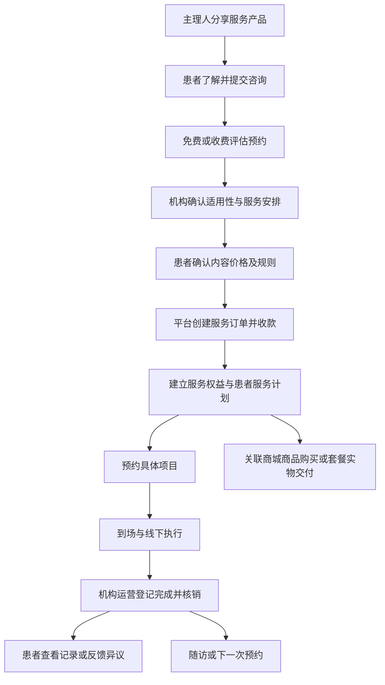

# 服务方案销售与多角色履约方案（评审稿）

日期：2026-10-13。状态：待用户评审，尚未实施。

本文作为业务与架构评审依据。标记为“已确认”的内容来自本次讨论；“推荐”及“待确认”内容不能直接视为最终实施规则。

## 1. 目标与已确认条件

场景：一个服务项目涵盖主理人推广、患者咨询或体验、预约、实际服务、配套商品与后续跟进。例如涉及糖尿病患者的机构服务，可能包含评估、医生确认的服务项目及实物交付。本文不定义治疗方法、适应证或疗效，相关决定由医疗机构和医生负责。

已确认：

- 平台收款；目前一个履约机构，后续可能增加机构。
- 支持免费咨询／体验、收费评估／体验、单次服务、多次套餐。
- 主理人负责推广协助，收益比例可配置。
- 医生和护士可以不操作平台，由机构运营协调并登记履约。

目标：患者能清楚购买、预约和查看服务；运营能协调人员与执行；平台能追踪订单、退款、收益与机构结算。

## 2. 方案选择与架构决策

| 方案 | 实现 | 优点 | 成本与限制 |
| --- | --- | --- | --- |
| A：服务订单与商城订单分别履约，推荐 | 服务方案关联商城商品，以患者服务计划串联 | 保持现有商城稳定，易于分阶段开发 | 患者可能有多张关联订单，页面需统一展示 |
| B：统一混合订单 | 同一订单包含实物、服务和预约项目 | 单一结算入口 | 发货、核销、套餐分摊及部分退款复杂，改造范围大 |

决策 ADR-01（待评审）：采用 A。服务产品作为展示与咨询入口；新增服务交易与履约模块；商城继续负责实物库存和商品交付。

决策 ADR-02（待评审）：维持现有 NestJS 模块化单体与 PostgreSQL，不引入微服务或通用工作流引擎。机构归属从第一版保存，多机构开放时补齐运营入口和隔离验收。

决策 ADR-03（待评审）：医生护士为机构人员名册，初期不强制创建登录账号。实际执行人员与平台登记人员分别记录。

决策 ADR-04（待评审）：初期结算单人工审核并登记付款，不自动转账或微信分账。渠道接入、合同和收款主体核实后再考虑自动化。

## 3. 业务对象：介绍、售卖、个体执行分别管理

### 3.1 服务产品

复用 `Product`。负责公开介绍、服务机构、适用人群、服务范围、流程、价格说明、咨询和预约入口。现有 `productType` 支持服务、实物介绍和组合方案，并不是商城交易实体。

### 3.2 可售服务方案

一个服务产品可维护多个方案：免费体验、单次评估、单次服务、多次套餐。

方案包括：机构、名称、项目及数量、售价、有效期、是否需先评估、预约要求、取消退款规则、配套实物、主理人默认收益规则。

服务项目分别定义执行内容和履约单位，例如“一次评估”“一次指定服务”。医疗项目必须由机构确认可以提供；不能因为患者购买套餐就跳过专业评估。

### 3.3 患者服务计划

个体服务计划关联咨询线索、服务订单、可用次数、预约、执行人员、商品交付与随访。专业调整保留版本和原因，涉及收费变化时要求患者确认及补款／退款处理。

公开售卖方案不等于个体诊疗方案。患者服务计划管理业务安排，不替代病历系统。

## 4. 患者流程与页面

收费评估先生成评估订单；免费咨询只生成线索；免费体验生成预约及明确的体验权益，不调用支付接口。经过适用性确认的可售项目，可以按配置直接购买。

小程序建议入口：

- 服务产品详情：了解项目、咨询、选择可售方案。
- 方案确认页：明细、价格、机构、预约／有效期／退款规则。
- 我的服务：服务计划、剩余次数、预约、服务记录、关联商品。
- 预约详情：时间、机构、到场指引、取消／改约。
- 服务订单与退款详情：收费和售后进度。

患者确认服务交付不是医疗知情同意，也不表示认可疗效。

## 5. 角色与权限

| 角色 | 主要职责 | 可见信息边界 |
| --- | --- | --- |
| 患者 | 咨询、确认、支付、预约、查看记录、售后 | 本人的订单与授权服务记录 |
| 主理人 | 分享、获客、协助预约、查看收益 | 授权线索、成交和收益，不默认查看医疗资料 |
| 医生 | 专业评估、确定／调整服务安排 | 初期通过机构线下流程处理，不要求登录平台 |
| 护士 | 配合执行、提供必要的执行事实 | 初期通过机构线下流程处理，不要求登录平台 |
| 机构运营／客服 | 排班、分配、改约、登记交付、处理咨询 | 所属机构业务；不得代替医生作专业决定 |
| 平台管理／财务 | 机构、订单、退款、结算与审计 | 根据职责授权，不默认无限访问医疗信息 |

运营登记必须保存实际执行人员、登记人员、执行时间、登记时间、完成依据及异常。核销撤销和记录修正需要原因及审计，不直接覆盖历史记录。

权限既检查动作，也检查机构与数据归属。初期一个机构也不能仅靠前端筛选防止跨机构访问。

## 6. 服务、实物与耗材关系

| 类型 | 业务处理 |
| --- | --- |
| 患者额外购买实物 | 正常商城订单，关联患者服务计划，独立支付和退款 |
| 套餐包含的实物 | 保存商品及数量快照，生成关联交付记录，按交付规则预留／扣减库存，不再次收费 |
| 服务执行耗材 | 由机构耗材系统管理；第一版不建立完整耗材系统 |
| 服务项目 | 预约、执行、次数核销，不套用商城发货状态 |

套餐实物交付的推荐落地方式：使用能识别“由服务订单承担费用”的商城交付订单，禁用其独立支付入口；此机制需要开发，现有商城不能直接创建这样的订单。避免将其误记为普通零元销售订单。

套餐内实物发生退款时，要统一检查服务、商品交付和套餐金额分摊，防止服务订单和商品订单重复退同一笔钱。第一版建议先上线不含实物的服务方案，关联商品另购；内含实物方案在交付与联合退款规则完成后开放。

## 7. 状态与预约权益

状态拆分，避免使用一个状态代表整个流程：

| 对象 | 建议状态 |
| --- | --- |
| 支付 | 未支付、已支付、部分退款、全部退款、关闭 |
| 预约 | 待确认、已确认、已取消、未到场、已到场、已完成 |
| 服务权益 | 可用数量、预约占用数量、已使用数量、退款冻结数量、已失效数量 |
| 执行 | 待执行、执行中、已完成、异常中止 |
| 结算 | 待计提、待结算、审核通过、已支付、已冲回 |

关键规则：

1. 支付以可信支付通知或渠道查询确认，前端支付回调不直接发放权益。
2. 预约占用权益与排班容量；实际完成服务才核销。取消释放占用。
3. 免费体验同样占接待容量，但不产生推广收益。
4. 后端事务校验次数、排班和容量，重复预约／核销不能重复扣减。
5. 无故未到场、迟到、临时改约、权益到期的规则需确认，不能默认扣次。
6. 付款超时释放占用；迟到支付通知进入异常处理，避免发放重复权益。
7. 医生变更服务项目时保留原购买内容，不直接改订单快照。

## 8. 定价、退款与资金边界

### 8.1 定价快照

订单创建时保存方案版本、项目数量、有效期规则、成交价、优惠、每个项目分摊金额、机构和收益规则。之后修改产品或比例，不改变已有订单。

金额以整数分保存，比例建议以整数基点保存；金额分摊总和必须等于实收金额，尾差确定地落到指定明细。

### 8.2 部分退款

推荐第一版人工审核：按订单快照和未使用项目金额计算，不在退款时用当前商品价格重新定价。

申请退款时冻结对应未使用权益，避免审核期间继续使用；拒绝或取消退款申请后释放。退款成功后终结相应权益，失败／关闭时保持异常待处理并由运营决定后续，不自动恢复可消费状态。

批准、提交渠道、渠道确认成功分别记录。渠道请求超时先查询，避免直接重复发起。服务退款复用支付渠道安全机制，但需要独立的权益和结算补偿逻辑。

已预约项目的退款需要先处理预约；套餐包含实物时联合核对交付状态和分摊金额。已使用项目退款、机构取消服务、例外退费需单独授权与记录。

### 8.3 平台收款与机构结算

平台负责收款账、退款账、主理人收益账和机构应付账。机构收入不能简单等于“实收减主理人收益”，还要明确合同中的平台留存、成本及各项费用承担。

**待确认：机构按固定服务成本、实收比例，还是按项目分别结算。** 第一版提供结算单，审核后线下付款并记录凭证，不自动转账。

平台收款的合同、商户主体、开票及多机构资金安排需要在正式收费前核实，不能仅根据已有微信支付可用就视为收款模式已满足要求。

## 9. 主理人归属与收益

推荐配置：方案默认比例，指定主理人可覆盖；订单保存生效规则快照。若存在机构专属规则，再增加机构维度，不预先增加任意规则引擎。

来源归属、服务成交与收益结算分别记录。建议订单确认页确定归属；多个推广来源竞争时采用首次还是末次有效来源、有效窗口以及人工调整权限，均待确认。

推荐计提基数为项目实际收款分摊金额，并排除已退款金额；服务完成后生成待结算收益，免费项目不计提。商品推广另设规则，不自动继承服务比例。

示例仅用于评审，不代表已确定政策：套餐实收 1,000 元，十次服务均分，每次 100 元，比例 10%。完成三次时可计提 30 元；余下七次退费 700 元，不计提相应 70 元。若对已使用部分例外退费，需要同步调整既有收益。

收益状态为预计、待结算、审核通过、已支付；退款生成撤销或冲回记录，不改已结算历史。已支付后的冲回通过未来结算抵扣还是追偿，待合同约定。

医疗场景的推广收益是否适用、计提方式和合作关系需审核，系统支持比例配置不代表业务规则已获准执行。

## 10. 与现有架构的对应

| 现有能力 | 复用方式 | 必要改造 |
| --- | --- | --- |
| `Product`、评估推荐 | 服务介绍、需求入口 | 关联可售服务方案 |
| `ProductLead`、跟进、邀请来源 | 咨询与主理人归属线索 | 关联服务计划和成交订单 |
| `Partner`、`PartnerMember` | 合作方及成员关系 | 明确履约机构归属；机构和主理人概念不能混用 |
| 用户与权限、协议、审计 | 登录、授权和操作记录 | 机构数据范围、患者授权、敏感信息访问审计 |
| `ShopProduct`、SKU、商城订单 | 配套实物另购 | 套餐内含实物需专门交付与联合退款机制 |
| 微信支付及退款渠道能力 | 签名、验签、查询、渠道调用 | 从当前依赖 `ShopOrder` 的业务中提取渠道能力 |

建议履约机构使用明确的 `ServiceInstitution` 模型，现有 `Partner` 保留合作方身份，可按需关联机构；机构人员名册 `InstitutionStaff` 可选绑定用户账号。没有登录账号也能作为预约和执行人员。

新增核心对象（字段为设计方向，不是最终数据库迁移）：

| 对象 | 关键内容 |
| --- | --- |
| `ServiceInstitution` | 机构、状态、接待地点和运营归属 |
| `InstitutionStaff` | 机构、医生／护士等职责、是否可预约、可选登录账号 |
| `ServiceOffering`、方案项目 | 关联服务产品、机构、价格、数量、规则版本 |
| `ServiceOrder`、订单项目 | 患者、线索、机构、价格与规则快照、支付状态 |
| `ServicePlan` | 患者、机构、服务安排、关联订单和线索 |
| `ServiceEntitlement`、权益流水 | 项目数量、预约占用、核销、退款冻结和撤销 |
| `ServiceAppointment` | 项目、时间、人员、容量、状态和变更原因 |
| `ServiceExecution` | 实际执行、登记人员、完成依据及异常 |
| 收益与结算流水 | 主理人、机构、订单项目、规则快照、计提与冲回 |

支付改造采用公共渠道适配层，商城与服务分别管理订单和支付／退款记录。通知路由根据可信支付记录识别业务类型，商户订单号唯一；渠道成功与业务权益更新需要幂等及失败补偿。不可直接把服务订单编号传给当前商城支付接口。

## 11. 安全、可靠性与运营约束

- 默认不采集完整病历。诊疗信息保留在机构系统，平台仅保存必要预约与交付信息。
- 明确区分购买人、付款人和接受服务的人；第一版推荐仅支持本人购买与使用，家属代购另行设计授权。
- 主理人只看授权范围内的转化与收益，不默认接触诊断、检查结果或治疗记录。
- 多机构数据按机构隔离；所有关键变更保存操作人、时间、前后结果及原因。
- 支付、退款、核销、收益记账必须防重；人工异常处理入口与渠道查询补偿同时规划。
- 监控付款未发权益、长期处理中退款、重复核销、负数权益、结算冲回未处理等异常。
- 医疗服务宣传、机构资质、患者授权与推广结算规则在正式开放前审核；平台不宣称治愈保证。

参考：[医疗广告管理办法](https://www.samr.gov.cn/zw/zfxxgk/fdzdgknr/ggjgs/art/2023/art_6584dc1c94c2408db7c73f0b5e3d225a.html)、[中华人民共和国个人信息保护法](https://www.samr.gov.cn/wljys/gzzd/art/2023/art_3ef1e889c1e644d4b65b5f5c7f432386.html%E3%80%82)。实际上线按届时有效规则和审核结果执行。

## 12. 实施阶段与验收

### 第一阶段：单机构完整闭环

完成免费咨询／体验、收费评估、单次及多次服务方案；服务订单、预约、权益、运营核销、退款；主理人比例配置与收益明细；机构结算单。配套商品先以商城另购方式关联。

医生护士不强制登录，运营代登记。先跑通单次服务，再开放多次套餐，两者属于同一阶段的逐步交付。

验收包括：咨询到成交可追溯；免费预约不调用支付；付款成功一次发放权益；预约不超次数／容量；重复核销不重复扣减；部分退款与冻结正确；比例修改不影响旧订单；退款收益冲回可追溯；越权访问被拒绝。

### 第二阶段：完善连续服务和商品联动

套餐内含实物交付及联合退款、更多改约和到期规则、随访任务、多机构运营入口与隔离验收；按实际需求决定是否接入机构已有系统。

### 第三阶段：自动化经营

经规则和渠道审核后接入自动结算／分账，完善经营报表；医生护士工作台仅在实际需要时建设。

## 13. 工程原则

- KISS：模块化单体、有限状态和人工运营，不先建设复杂工作流。
- YAGNI：不强制医生护士登录，不先建病历系统、耗材系统或自动分账。
- SOLID：产品介绍、服务交易、预约执行、商品交付与资金结算分别负责自己的规则。
- DRY：商品库存、用户、线索、渠道支付能力复用；状态和计价规则集中定义。

如果为了统一页面而把预约、诊疗与商城发货合并成一个状态，会违背职责边界，应保持后台独立对象，前台统一展示。

## 14. 请重点评审

| 项目 | 推荐或待确认内容 | 评审结果 |
| --- | --- | --- |
| 总体模式 | 服务订单独立，患者服务计划关联商城商品 | 待评审 |
| 医生护士操作 | 初期不登录，运营代登记，执行与登记人员分开记录 | 待评审 |
| 首期售卖 | 免费、收费、单次、多次均支持；先不开放套餐内含实物 | 待评审 |
| 机构结算 | 固定成本、比例或按项目结算；费用和开票责任 | 待确认 |
| 主理人比例 | 方案默认＋指定主理人覆盖；金额基数、封顶和适用范围 | 待确认 |
| 来源归属 | 首次／末次来源、归属窗口、人工调整权限 | 待确认 |
| 结算时点 | 完成交付后计提；审核／结算周期和售后等待期 | 待确认 |
| 退款 | 未使用按快照退；已使用例外退款及已付收益冲回规则 | 待确认 |
| 预约规则 | 提前取消、迟到、未到场、有效期及机构取消 | 待确认 |
| 到场与完成依据 | 谁确认、需要何种证明、患者异议处理 | 待确认 |
| 患者范围 | 首期本人购买使用；是否必须支持家属代购 | 待确认 |
| 专业数据边界 | 平台只存必要业务信息；是否存在病历系统对接需求 | 待确认 |
| 收款与推广模式 | 商户／合同主体、机构资质、宣传及收益规则审核 | 待确认 |

评审通过后再拆分实施任务、细化数据结构与 API；本文不会自动触发开发、收费、支付分账或正式发布。
