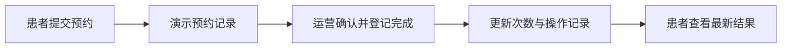

# 从需求确认到可点击原型的方法

本文总结一套可以用于其他项目的工作方式：先确认产品规则，再编写能操作、能切换角色和状态的页面原型，通过浏览器实际走流程，最后将评审结果交给正式开发。

适用于预约、交易、审批、售后、任务分派等多人参与的产品。静态图可以表达布局；可点击原型还可以验证“谁在何时做什么、操作后发生什么”。

## 1. 这项能力由什么组成

| 能力 | 作用 | 本次项目的使用方式 |
| --- | --- | --- |
| 需求梳理 | 确定角色、流程、业务规则和异常情况 | 将服务购买、预约、核销、退款与收益写成需求确认文档 |
| 交互与视觉设计 | 设计页面层级、主按钮、状态和视觉风格 | 用 ui-ux-pro-max 指导页面设计，沿用项目绿色品牌 |
| 前端代码 | 让页面真正可以点击和改变状态 | HTML、CSS、JavaScript，实现患者手机预览和运营工作台 |
| 演示状态管理 | 多页面、多角色共享同一份业务进度 | 在浏览器本地存储演示订单和操作记录 |
| 浏览器自动化 | 实际点击、填表并核对结果 | 用 Playwright 检查购买、预约、完成、退款与窄屏显示 |
| 本地预览 | 提供可打开的评审地址 | 用 Python 静态服务器启动原型 |

技能提供设计或操作指导，页面由代码实现，浏览器负责运行。使用这套方法不要求先创建新的 Codex 技能，也不要求使用 Figma。

## 2. 在新项目中选择实现方式

| 方式 | 适用场景 | 优点 | 限制 |
| --- | --- | --- | --- |
| 独立网页原型，优先推荐 | 需求评审、业务规则较多、暂不接接口 | 启动简单、容易隔离演示数据、便于迁移 | 无法完全还原微信或原生应用特有能力 |
| 在项目现有前端中建立原型入口 | 必须复用复杂组件、原型需要高度贴近正式界面 | 复用样式和组件，减少之后的页面重做 | 依赖项目运行环境，需要明确隔离演示入口与真实接口 |

先检查项目已有组件和样式。独立原型采用普通浏览器能力；需要复杂组件时使用项目已安装的框架和组件库。不要仅为几个演示页面新增一套框架。

原型页的能力由评审目标决定。第一轮选择一条完整主流程和关键异常，说明其余页面的范围；已经确认的业务需求仍保留在需求文档中。

## 3. 开始前需要的输入

- 产品要解决的问题，以及这一轮要确认的内容。
- 参与角色及操作权限。
- 已确认的业务规则，尤其是价格、期限、退款和审批条件。
- 目标界面：手机、小程序、网页后台或其他。
- 已有品牌、界面或组件参考。
- 演示边界：使用虚构数据；需要模拟哪些结果。

缺少具体设计时，先形成一套可评审方案，区分用户已确认的条件与设计者选定的规则。用户确认后记录版本与日期。不要把未确认的推测写成用户已经认可的要求。

## 4. 标准工作流程

### 第一步：写清需求

先写患者、客户、员工等真实使用者能读懂的产品说明：

1. 从哪里进入、要完成什么。
2. 每个页面展示什么、有哪些主要按钮。
3. 按钮可以在什么条件下使用。
4. 操作后由谁继续处理、页面如何变化。
5. 取消、失败、超时、重复操作如何处理。

需求文档以用户行为和产品规则为主。数据库和接口设计在后续技术方案中说明。

### 第二步：确定页面与状态

把“业务流程”转成“页面入口与下一步行动”。例如：

| 页面 | 主要展示 | 主操作 | 关键状态 |
| --- | --- | --- | --- |
| 产品详情 | 内容、价格、条件、机构 | 咨询或选择方案 | 可购买、需要评估、暂停购买 |
| 我的服务 | 剩余次数、预约、完成记录 | 预约下一次 | 可用、已预约、售后冻结、结束 |
| 预约详情 | 时间、地点、人员、须知 | 查看安排或取消 | 待确认、已确认、到场、完成 |
| 退款详情 | 内容、金额、进度 | 查看进度或联系客服 | 待审核、处理中、成功、异常 |

每个关键页面都考虑首次空白、加载中、加载失败、无权限、暂不可操作等情况。失败后要有明确的重试或返回路径。

### 第三步：设计视觉层级

延续项目品牌，统一颜色、字号、间距、圆角和按钮样式。页面只突出当前最重要的行动；退款、取消等辅助动作保留清楚的入口。

患者端突出“下一步、剩余内容、最新进度”；运营端突出“待办、处理依据、下一步操作”。原型的角色切换和场景载入工具放在评审区域，不放进正式产品流程。

### 第四步：建立演示记录

先定义简明的演示业务对象，再让页面从同一份记录生成内容。角色切换只改变视图，不创建两份互不相干的数据。

以服务为例，分别记录购买、预约、实际完成、退款和收益。支付成功不直接表示预约成功，批准退款不直接表示已到账。



实现时保持以下约束：

- 重复点击完成不能重复扣次，退款成功不能重复累计。
- 提交部分退款只冻结所选内容；未涉及的内容仍能使用。
- 模拟支付与模拟渠道结果使用明确的演示标签。
- 使用项目专属的本地存储名称，避免影响真实应用的登录和数据。
- 提供恢复初始状态及几个关键场景的入口。
- 展示用户输入时正确处理特殊字符，避免将输入当作页面代码。

本地存储是方便评审的演示记录，不作为正式系统的权限或支付依据。

### 第五步：制作可运行原型

独立原型建议使用以下目录：

```text
docs/
  product/
    <主题>-requirements.md
  prototypes/
    <主题>/
      index.html
      styles.css
      app.js
      README.md
```

分别负责入口、样式、交互和评审说明。保持源代码可阅读；原型无需构建时直接运行，不必添加依赖或打包流程。

从新项目仓库根目录启动，替换主题目录：

```bash
python3 -m http.server 4178 --bind 127.0.0.1 --directory docs/prototypes/<主题>
```

浏览器打开 `http://127.0.0.1:4178`。端口被占用时换用空闲端口；这个地址仅在启动服务的电脑上可用。直接打开 `index.html` 也可预览，但浏览器对本地文件存储的支持可能不同。

### 第六步：用浏览器核对流程

用 Playwright 或等效浏览器工具，通过实际按钮和表单完成流程。重点核对行为和结果，而不是只判断按钮是否存在。

建议检查：

| 检查 | 需要看到的结果 |
| --- | --- |
| 一条完整主流程 | 从入口走到结束，角色之间能继续处理 |
| 关键金额与数量 | 价格、次数、退款和剩余内容符合需求 |
| 撤回与取消 | 正确释放或恢复占用，不错误恢复已取消的预约 |
| 异常与重复操作 | 状态可恢复，重复动作不重复记账或扣次 |
| 刷新与场景切换 | 演示数据按说明保留或重置 |
| 手机与桌面 | 主按钮可见，无横向溢出，弹窗与长内容可操作 |
| 键盘与表单 | 控件有标签，焦点可见，弹窗可关闭，必填内容能校验 |

金额用整数分计算，再显示为元。需要验证时，通过实际交互生成记录，检查最后的次数、金额和状态；不要直接修改记录后宣称流程通过。

截图可以辅助视觉评审，实际点击用于检查交互。截图超时、浏览器错误和检查失败分别记录；没有完成的检查不写成已经通过。截图和临时快照按项目规则存放，避免混入产品源文件。

### 第七步：交付评审入口

交付内容包括：

- 可打开的地址及停止、重启方法。
- 推荐体验顺序。
- 可以直接载入的场景。
- 当前支持的页面与交互。
- 模拟、说明性入口与尚未展开的范围。
- 已完成的检查及实际限制。

评审时记录“页面、触发条件、期望行为、实际行为”。涉及业务规则的调整先更新需求依据，再调整原型，避免文档与页面出现两套规则。

## 5. 在其他项目中直接使用的提示词

### 已有需求时

```text
参考《从需求确认到可点击原型的方法》，为当前项目制作可点击交互原型。

需求依据：<需求文档路径>
目标角色：<客户、运营等>
目标界面：<小程序患者端、网页运营后台等>
品牌参考：<现有页面或样式路径>
重点流程：<购买、预约、执行、退款等>

先检查已有页面和组件，再制作能共享演示记录的原型。
包含关键状态、异常和主要操作，提供场景载入和重置。
用虚构数据模拟结果，完成浏览器交互检查。
将原型和评审说明放进 docs/prototypes，更新 docs 索引。
交付可打开的预览地址，明确模拟范围与检查结果。
```

### 尚未确认需求时

```text
先参考《从需求确认到可点击原型的方法》整理产品需求确认文档。

业务场景：<描述>
参与角色：<描述>
已经确定的规则：<描述>

给出一套具体产品方案，写清各角色的流程、页面、按钮、状态与业务规则。
提供需求确认清单；确认后再制作可点击原型。
```

### 评审修改时

```text
继续修改现有原型，依据仍为 <需求文档及版本>。
需要调整：<页面、触发条件、期望结果>。
保留已有场景与演示进度，对受影响流程做浏览器检查。
涉及业务规则变更时同步更新需求文档和评审说明。
```

新项目不会自动包含这份方法文档。使用时提供文件路径、复制到该项目 `docs`，或在项目的 `AGENTS.md` 中明确引用。只有明确要求创建或安装可调用技能时，再将成熟流程封装为技能。

## 6. 从原型到正式开发

原型确认后，先列出页面、操作、角色权限和业务状态，再形成开发任务。

| 原型内容 | 正式开发中要实现的能力 |
| --- | --- |
| 演示患者与角色切换 | 登录、身份与数据访问范围 |
| 浏览器本地演示记录 | 服务端数据与可靠更新 |
| 模拟支付和退款结果 | 真实渠道、验签、查询与异常处理 |
| 手动登记状态 | 权限、审计、并发与重复操作保护 |
| 场景载入工具 | 独立的开发验证数据，正式页面不提供 |
| 演示消息与客服弹窗 | 实际消息授权、客服配置和失败处理 |

正式页面可以沿用已确认的布局与交互。交互原型检查通过，不代表真实支付、后端权限、微信真机或正式发布已验收。

## 7. 本次项目的实例

项目 `blisstribe` 使用这套方法制作了服务方案原型：

- 需求文档：`docs/product/SERVICE_PROGRAM_REQUIREMENTS.md`。
- 原型目录：`docs/prototypes/service-program/`。
- 角色：患者端、机构运营。
- 主流程：咨询、免费体验、评估资格、购买、预约、到场、完成、退款。
- 快速场景：首次咨询、可购买、已购买、待确认预约、已完成三次、剩余七次退款、无档期。
- 核对实例：套餐中十次服务共分摊 900 元；完成三次后退剩余七次，金额为 630 元。
- 原型边界：一个虚构机构与患者；物流退货、完整复核、方案替换和完整结算未展开。

核心可复用内容是工作流程、状态边界、角色协作和评审方法。新项目的业务名称、定价、权限与售后规则要依据自身需求重新定义。

## 8. 文档与 Obsidian 同步约定

本方法以项目中的 `docs/engineering/INTERACTIVE_PROTOTYPING_PLAYBOOK.md` 为维护版本。Obsidian 保存同内容副本，放在资源分类下，便于跨项目查阅。

本方法文档最初以手动方式写入本机知识库。后续修改时再次更新该笔记；如果 Obsidian 副本有独立笔记，先合并或备份，不能直接覆盖。
2026-10-14 已配置 Obsidian 自建 WebDAV 同步，设备接入与备份说明见项目 `docs/operations/OBSIDIAN_SELF_HOSTED_SYNC.md`。本方法从项目到 Obsidian 的副本更新仍是独立操作；笔记保存后通过 Remotely Save 在设备间同步，外部写入可执行手动同步或等待周期同步。


不将支付密钥、登录令牌、真实患者资料或临时浏览器记录同步进方法文档。原型源码仍在项目仓库中，Obsidian 中通过本方法和项目路径查找。

## 9. 工程原则

- KISS：用最少的运行环境完成具体评审，优先普通网页和项目已有能力。
- YAGNI：先完成确定的关键流程，不为原型建设完整后台、支付系统或通用工作流。
- DRY：不同角色共享一份演示记录，状态规则与计算集中处理。
- SOLID：页面展示、业务状态、视觉样式与评审说明职责清楚，便于将来替换为真实服务。
