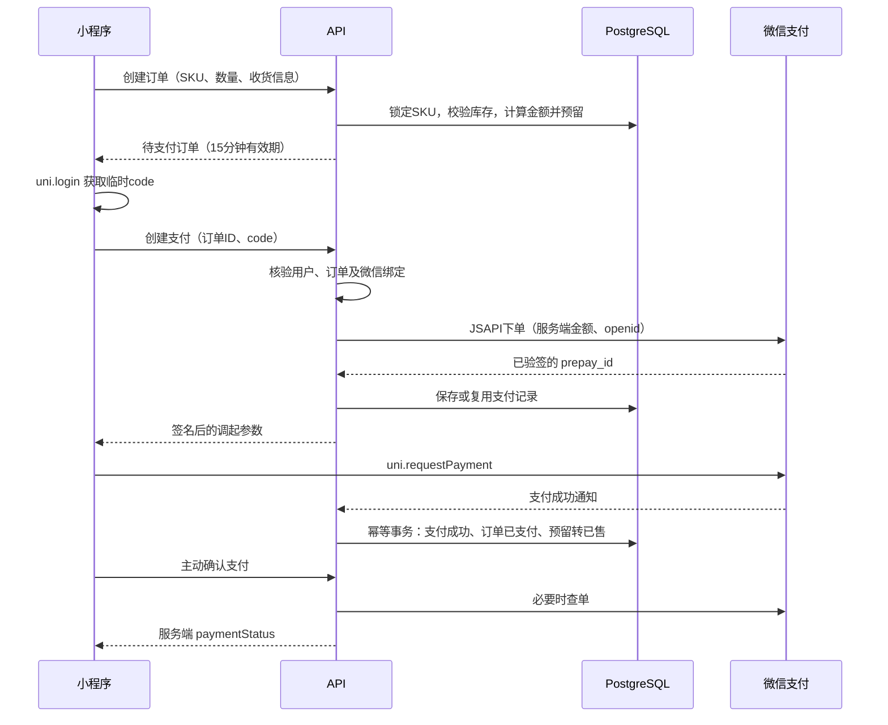
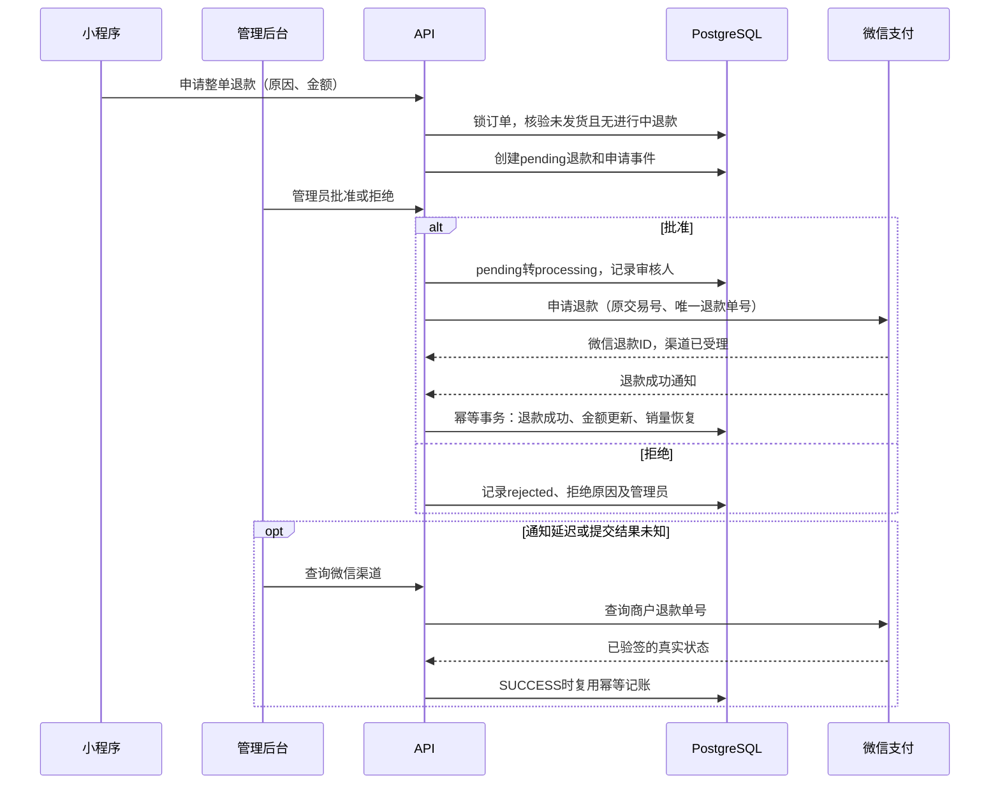

# 商城付款与退款技术实现

更新时间：2026-10-12。本文按当前源码说明实际实现，覆盖小程序、后台、API、微信支付和 PostgreSQL；不代表所有流程均已完成生产验收。

相关文档：[部署指南](../operations/DEPLOYMENT_GUIDE.md)、[微信支付配置与验收记录](../operations/WECHAT_PAY_DEPLOYMENT.md)、[商城架构](../designs/shop/shop-module-design-optimized.md)。

> 其他应用的可复用架构设计见 [支付与退款参考技术架构](PAYMENT_REFUND_REFERENCE_ARCHITECTURE.md)。本文仅说明本项目实现。

## 1. 实现范围与技术栈

- 小程序：uni-app、Vue，通过 `uni.login` 和 `uni.requestPayment` 调起微信支付。
- 后台：Vue、Element Plus，订单管理进入退款详情或审核，退款管理执行批准、拒绝和渠道查单。
- API：NestJS 模块化单体，`WechatPayService` 直接调用微信支付 API v3，未引入额外支付 SDK。
- 数据库：Prisma、PostgreSQL；订单、支付、退款和库存通过事务、行锁、条件更新保证一致性。
- 支持平台自营实物商品、未发货订单的整单退款；当前不支持任意部分退款、多商家分账或发货后退货退款。
- 金额使用整数“分”，不以浮点“元”存储或计算。页面展示时才除以 100。

当前小程序开发与生产环境都连接 `https://api.ytxybl.com/api/v1`。本地开发页面不意味着模拟支付，实际模式由它连接的 API 配置决定。

## 2. 模块与数据模型

| 模块/模型 | 职责 |
| --- | --- |
| `OrderService` | 服务端计价、创建订单、预留库存、发货 |
| `PaymentService` | 创建支付、主动确认、成功记账、取消前查单关单 |
| `WechatPayService` | 微信请求签名、应答/通知验签、通知解密、渠道支付与退款接口 |
| `RefundService` | 用户申请、管理员审核、渠道查单、退款成功记账 |
| `ShopOrder` / `ShopOrderItem` | 订单状态、金额、收货信息及商品/SKU/价格快照 |
| `ShopPayment` | 商户订单号、预支付 ID、微信交易号及支付结果 |
| `ShopRefund` | 申请金额、审批人、商户退款单号、微信退款 ID、渠道结果及完成时间 |
| `ShopRefundEvent` | 用户、管理员、系统和微信渠道的操作轨迹 |
| `ShopPaymentException` | 订单取消后收到成功付款等需人工核查的异常 |
| `ShopProductSku` | 总库存、预留库存、已售数量 |

库存口径：

```text
可售库存 = totalStock - reservedStock - soldStock
```

总库存是库存容量基数，支付和退款通过预留、已售变化影响可售数量；不会同时扣减总库存。

## 3. 付款流程



### 3.1 创建订单与预留库存

`OrderService.createOrder` 读取真实 SKU 和价格，并通过数据库行锁防止并发超卖。校验商品可用、SKU 启用及数量合法，不信任客户端提交的价格或合计。

事务中保存商品名称、规格、价格等快照，并增加 `reservedStock`。订单初始为 `status=pending_payment`、`paymentStatus=unpaid`、`fulfillmentStatus=pending`，有效期约 15 分钟。后续修改商品不会改变已创建订单的金额快照。

### 3.2 下单与支付参数

小程序先 `uni.login`，提交临时 code。API 从 JWT 获取当前用户，兑换微信 OpenID 并核验与该用户绑定的微信身份，随后检查订单归属、支付状态和过期时间。

真实渠道调用 `POST /v3/pay/transactions/jsapi`，使用服务端订单金额、商户号、AppID、OpenID、支付通知地址及过期时间，取得 `prepay_id`。

已有待支付的预支付记录时直接复用。`PaymentRepository.create` 按唯一商户单号执行 upsert，更新预支付 ID，不覆盖已成功支付状态。

返回小程序 `timeStamp`、`nonceStr`、`package=prepay_id=...`、`signType=RSA`、`paySign`。小程序调用 `uni.requestPayment`；客户端不会持有商户私钥或 API v3 密钥。

### 3.3 支付确认与到账记账

前端收银台成功或失败后，都尝试调用主动确认接口。只有服务端返回 `paymentStatus=paid` 才显示支付成功；收银台成功但服务端仍未确认时提示结果确认中。若用户取消但渠道已付款，查单可以纠正前端结果。

支付通知或查单确认成功后调用 `handleWechatNotify`，在同一事务中：

1. 核对商户订单号、微信交易号、支付金额。
2. 通过条件更新将待支付或关单中的订单转为 `paid`，填写 `paidAt`。
3. 更新或补建 `ShopPayment`，保存微信交易号、成功状态和付款时间。
4. 每个 SKU 的预留减少、已售增加，数量必须与订单一致。

同一交易重复通知直接幂等返回，不重复扣库存；同一订单出现不同成功交易号则拒绝。已取消订单收到成功付款时记录支付异常供人工核查，不直接恢复订单或自动退款。

### 3.4 取消与过期订单

每 5 分钟检查过期待支付或 `closing` 订单。用户取消及过期处理都会先查微信：

- 微信已支付：按成功结果记账，不取消。
- 尚未付款：先请求微信关单，再确认可关闭。
- 已关闭、撤销、支付失败或已验签确认渠道订单未创建：取消本地订单并释放预留。
- 超时、通信失败或结果不确定：继续保留订单和库存，后续再核对。

“用户关闭收银台”不等于“订单已取消”，也不能据此立即释放库存。

## 4. 退款流程



### 4.1 用户申请

用户必须是订单所有者，订单已支付且未发货。申请金额必须等于剩余实付金额：

```text
requestedAmountFen = paymentAmountFen - refundedAmountFen
```

事务内锁定订单、重新检查条件，并阻止 `pending`、`approved`、`processing` 等进行中申请。创建唯一商户退款单号和 `pending` 退款记录，记录用户提交事件。申请本身不发起微信退款，也不恢复库存。

小程序显示当前退款状态，进行中申请改为“查看退款”。进入退款申请页发现已有不可重复申请的记录时跳转详情，订单页在返回时重新加载。

### 4.2 后台审核

订单页的“处理退款”进入对应审核弹窗，退款列表也有审核图标。审核前重新获取详情：只有待审核申请可以批准或拒绝。

批准通过订单行锁和 `pending` 条件更新，先转为 `processing`，记录批准金额、审核人、时间、意见和事件，再向微信申请退款，避免重复审批产生重复渠道请求。

调用 `POST /v3/refund/domestic/refunds`，提交原微信交易号、唯一商户退款单号、退款金额、原订单金额及退款通知地址。当前仅支持未发货整单退款，渠道适配器退款金额和原金额按整单实现；扩展部分退款前必须调整接口参数与校验。

渠道受理后保存微信退款 ID，并保持 `processing`。提交超时或异常视为结果未知，记录 `provider_result_unknown`，仍保持处理中，不重置成可再次审批状态。

拒绝记录原因和管理员，状态转为 `rejected`，不调用微信、不恢复库存。

### 4.3 微信成功结果与原路退款

微信负责将款项原路退回用户支付账户。系统没有单独转账给用户，也不需要用户提供新的收款账户。

通过成功通知或已验签查单确认 `SUCCESS` 后，`handleRefundCallback` 在同一事务中：

1. 将退款从 `processing` 条件更新为 `success`，保存微信退款 ID 和本地完成时间。
2. 核对退款金额、原订单金额与当前剩余可退款金额。
3. 校验订单仍未发货，减少对应 SKU 的 `soldStock`，恢复可售库存。
4. 累加订单 `refundedAmountFen`，设置 `fulfillmentStatus=refunded`。
5. 记录退款成功事件；任何一步失败，全部回滚。

同一微信退款 ID 的重复成功通知不会重复累加金额或恢复库存。发货与退款申请、审批使用订单锁，发货还会检查进行中退款，防止两条链路同时推进。

### 4.4 渠道查单及异常状态

后台“查询微信结果”调用微信 `GET /v3/refund/domestic/refunds/{out_refund_no}`。仅处理本地仍为 `processing` 的退款。

若渠道成功，必须核对商户退款单号、退款 ID、退款金额和原金额，再复用成功处理逻辑。查询失败记录未知，金额或单号不匹配记录异常，不盲目更新订单或库存。

收到 `CLOSED`、`ABNORMAL` 等渠道状态，目前只记录状态和事件、保留处理中供核查，未实现完整的异常退款自动恢复或重新退款入口。

## 5. 为什么订单仍显示“已支付”

| 字段 | 表达的事实 | 退款成功后的当前值 |
| --- | --- | --- |
| `ShopOrder.status` | 订单主状态 | 通常仍为 `paid` |
| `paymentStatus` | 原付款是否成功 | `paid` |
| `fulfillmentStatus` | 履约终态 | `refunded` |
| `refundedAmountFen` | 已成功退款金额 | 整单实付金额 |
| `ShopRefund.status` | 本次售后处理状态 | `success` |

付款曾经成功的事实不会因为退款抹掉。页面综合退款记录和履约状态显示“已退款”，而不是只看订单主状态。后台分别展示支付、履约、退款状态，并隐藏进行中退款的发货入口。

当前 API 不直接证明用户手机已显示入账：微信 `SUCCESS` 是渠道完成依据，用户可在原微信支付账单或银行账户核对。批准或渠道受理不能显示为已到账。

## 6. 安全与凭证

### 6.1 请求签名与应答验签

商户私钥使用 RSA-SHA256，对请求方法、路径与查询串、时间戳、随机串和原始请求体构造签名，生成 `WECHATPAY2-SHA256-RSA2048` Authorization。请求携带 `Wechatpay-Serial` 指定微信支付公钥 ID。

微信应答先验签再解析使用：检查签名时间、随机串、公钥 ID及签名。仅已验签且符合指定错误码的订单未创建结果允许进入关单补偿，不能将普通网络错误解释为未支付。

小程序调起参数另用商户私钥签名，前端只接收调起所需参数。

### 6.2 通知验签与解密

NestJS 开启 `rawBody`，支付/退款控制器读取官方 `Wechatpay-*` 请求头，用未经重序列化的原始请求体执行 RSA 验签。通过后用 API v3 密钥和通知中的 nonce、associated_data，按 AES-256-GCM 解密资源。

支付通知校验 AppID、商户号、成功状态和人民币币种；退款通知校验商户、状态与金额。退款通知金额结构不要求 `currency` 字段，字段存在时才检查是否为 CNY；不能直接照搬支付通知字段要求。

拒绝无效签名返回 HTTP 401，处理失败返回 HTTP 500，成功返回微信要求的原始 SUCCESS 响应，跳过业务响应包装，允许微信重试。错误签名探测流量应拒绝，不能为了消除日志而放宽验签。

### 6.3 配置与开关

| 配置 | 用途 |
| --- | --- |
| `WX_APP_ID` / `WX_APP_SECRET` | 小程序登录身份兑换 |
| `WECHAT_APP_ID` / `WECHAT_MCH_ID` | 支付应用和商户 |
| `WECHAT_MCH_PRIVATE_KEY` / `WECHAT_MCH_CERT_SERIAL_NO` | 商户签名及证书序列号 |
| `WECHAT_API_V3_KEY` | 通知解密 |
| `WECHAT_PLATFORM_PUBLIC_KEY` / `WECHAT_PLATFORM_SERIAL_NO` | 微信应答与通知验签 |
| `API_BASE_URL` | 构造支付和退款通知地址 |
| `WECHAT_PAY_ENABLED` | 微信渠道调用开关 |
| `SHOP_PAYMENT_CHECKOUT_ENABLED` | 是否允许新支付；暂停时保留查单、退款和通知 |
| `SHOP_PAYMENT_TEST_USER_ID` | 新支付暂停期间允许的单个验收用户 |
| `SHOP_PAYMENT_MOCK_ENABLED` | 仅非生产环境允许启用模拟支付 |

密钥在服务器 `/etc/blisstribe/api.env`，不进入文档或 Git。当前只支持配置的一份微信验签公钥，不包含平台证书下载和自动轮换；更换公钥需同步配置并验证。

## 7. 主要接口

以下路径均相对 API 前缀 `/api/v1`，业务接口需要对应用户或管理员身份；通知接口依靠微信签名鉴别渠道。

| 方法 | 路径 | 作用 |
| --- | --- | --- |
| POST | `/shop/orders` | 创建订单、预留库存 |
| POST | `/shop/orders/:id/payment` | 创建或复用预支付 |
| POST | `/shop/orders/:id/payment/query` | 用户主动确认支付 |
| POST | `/shop/orders/:id/cancel` | 查单关单后取消 |
| POST | `/shop/webhooks/wechat-pay` | 微信支付通知 |
| POST | `/shop/orders/:id/refund` | 用户申请退款 |
| GET | `/shop/refunds/:id` | 用户退款详情 |
| GET | `/admin/shop/refunds` | 管理员退款列表 |
| GET | `/admin/shop/refunds/:id` | 管理员详情与事件 |
| POST | `/admin/shop/refunds/:id/approve` | 批准并提交微信退款 |
| POST | `/admin/shop/refunds/:id/reject` | 拒绝申请 |
| POST | `/admin/shop/refunds/:id/query-provider` | 查渠道并补偿成功记账 |
| POST | `/shop/webhooks/wechat-refund` | 微信退款通知 |

## 8. 生产验收与当前限制

截至 2026-10-12：

- 真实 0.01 元付款成功，支付记录和订单均确认成功，预留正确转为已售。
- 管理员批准退款后，微信已验签查单确认 SUCCESS；订单退款金额和库存已通过幂等处理补齐。
- 首次真实退款通知返回 401。检查发现强制要求退款通知 `currency` 的兼容性错误，已修复并部署；未经真实重试成功确认，不能认为通知链路完整验收。
- 用户手机到账确认尚未收到反馈。
- 30 分钟定时对账仅检查本地账务异常并记录日志，尚未自动查询长期处理中的退款；当前补偿依赖后台查渠道。
- 自动渠道核对、异常退款恢复、通知失败可观测性和平台发货管理仍需完善或核查。
- 公共新支付仍保持暂停；恢复前核对真实验收和凭证更新状态。

真实通知与已验签查单都是可信渠道结果，但查单成功不能替代通知链路验收。系统生成的本地 `completedAt` 是记账处理时间，当前没有单独持久化微信 `success_time` 或退款去向字段，不能把它当作银行入账时间。

## 9. 源码入口与检查资料

- `apps/api/src/shop/order/order.service.ts`
- `apps/api/src/shop/payment/payment.controller.ts`
- `apps/api/src/shop/payment/payment.service.ts`
- `apps/api/src/shop/payment/payment.repository.ts`
- `apps/api/src/shop/payment/wechat-pay.service.ts`
- `apps/api/src/shop/refund/refund.controller.ts`
- `apps/api/src/shop/refund/refund.service.ts`
- `apps/api/src/shop/common/tasks/expired-order.task.ts`
- `apps/api/src/shop/common/tasks/reconciliation.task.ts`
- `apps/miniapp/src/api/modules/shop.ts`
- `apps/admin/src/views/shop/order.vue`、`refund.vue`
- `apps/api/prisma/schema.prisma`

相关测试包括 `tests/shop/payment-safety.spec.ts`、`wechat-pay-adapter.spec.ts`、`payment-webhooks.spec.ts`、`refund-service.spec.ts`、`refund-recovery.spec.ts` 和 `payment-flow.check.js`。隔离数据库检查使用模拟微信渠道，不能替代真实扣款/退款验收；最近新增与修改用例不因本文编写而自动视为已运行。

## 10. 工程取舍

- KISS：一个微信渠道适配器配合现有订单、支付、退款服务，避免新增支付网关或微服务。
- DRY：通知和可信查单复用成功记账，避免两套库存与账务更新逻辑。
- SOLID：界面负责交互，服务负责规则，适配器负责渠道，数据库负责原子一致性。
- YAGNI：当前限定未发货整单退款；部分退款、分账和证书自动轮换按明确业务需要再扩展。

微信通知契约参考：[微信支付官方小程序退款回调文档](https://pay.wechatpay.cn/doc/v3/merchant/4012791906)。后续改变渠道字段或接口时重新核对官方定义。
