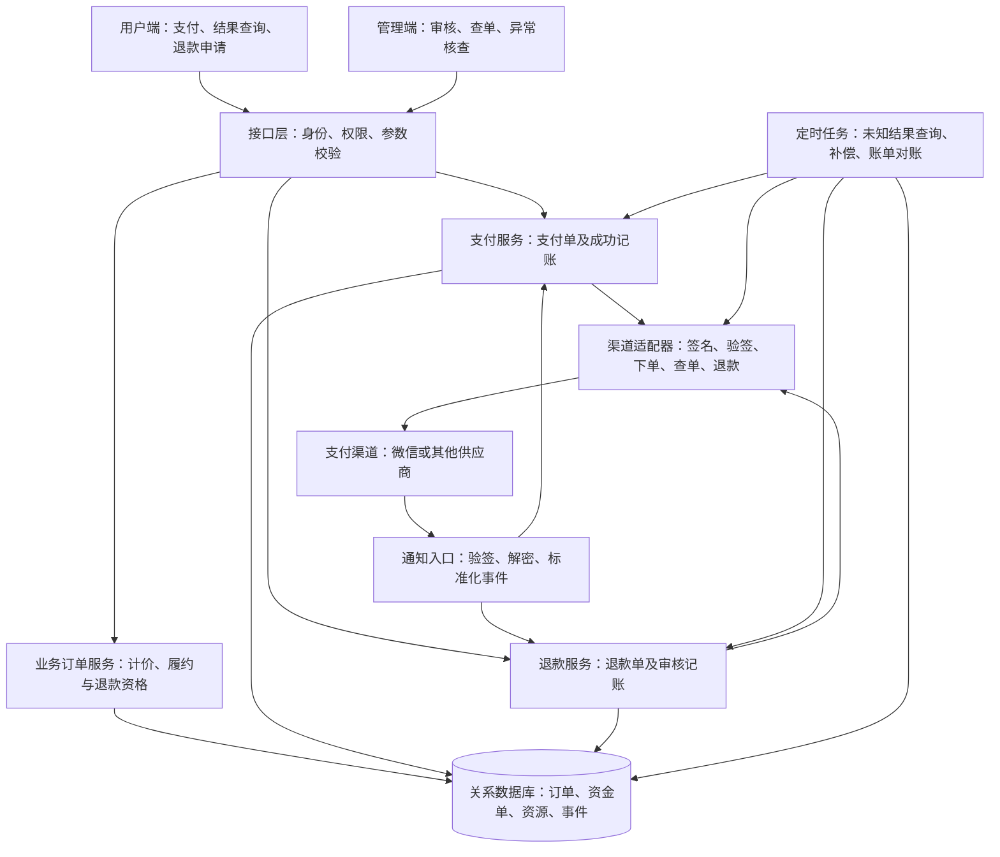
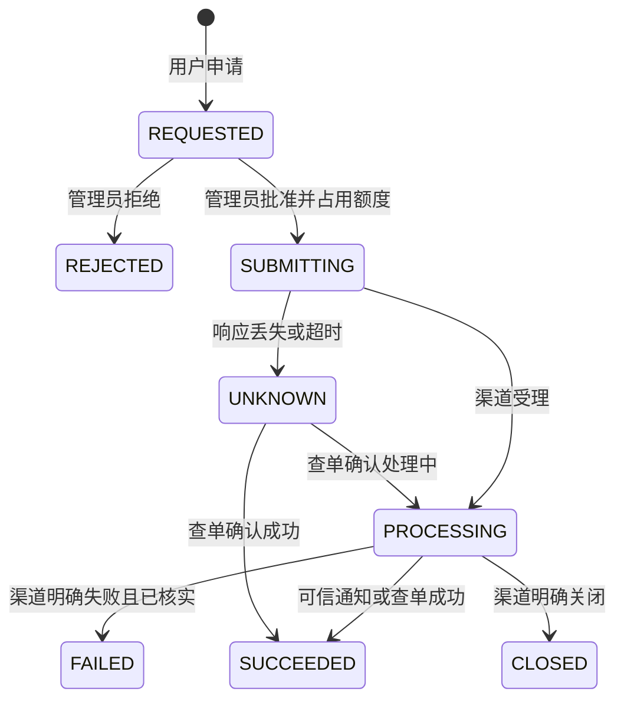
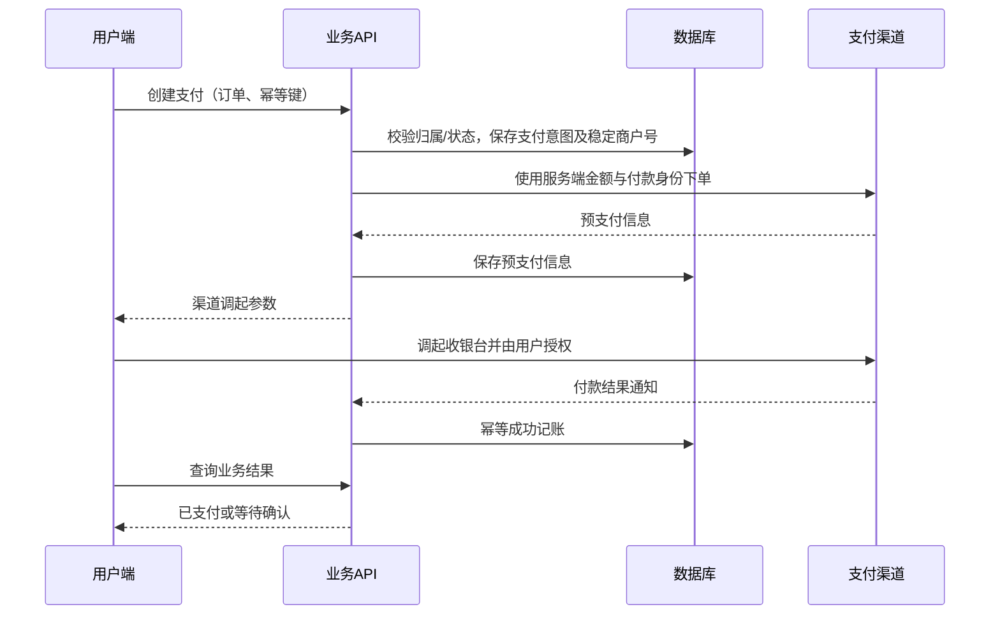

# 支付与退款参考技术架构

版本：1.0；日期：2026-10-12。

## 1. 文档目标与适用范围

本文是可迁移到其他应用的架构设计，回答：支付与退款应分为哪些模块，数据如何存储，如何可靠地调用第三方渠道，如何解决重复通知、超时、并发和账务不一致。

适用于商城、付费预约、课程和会员购买等应用。默认起步场景是单商户、单币种、一次付款、整单退款；实物库存只是其中一种业务资源，其他应用可替换为预约名额或服务权益。

本文描述推荐目标架构，包含自动补偿等能力，不表示现有项目已经全部实现。本项目实例另见 [付款与退款技术实现](PAYMENT_AND_REFUND.md)。

### 功能与可靠性要求

- 后端确定价格，绑定支付人与业务订单。
- 用户支付、后台审核退款、渠道查询、回调通知、人工核查闭环。
- 不重复扣款、不重复退款、不重复扣库存或恢复权益。
- 网络超时不能被当作资金操作失败，未知结果必须可查询、恢复和追踪。
- 每笔金额能追溯至业务订单、渠道交易、退款单与处理记录。
- 具体可用性、延迟和容量目标按应用实际规模确定，不假设某个技术栈自然满足。

## 2. 架构分层



推荐第一版部署为模块化单体：业务模块共享关系数据库，但权限、渠道协议和业务规则保持独立。这样可以先用数据库事务实现订单、资金记录和资源变化的一致性。

只有存在多个独立业务系统、专门的支付团队或明确的流量隔离需求时，再考虑独立支付服务。拆服务后跨库操作不能沿用单库事务，需要事务发件箱（Outbox）、可靠事件和补偿机制，运维成本明显增加。

### 模块边界

| 模块 | 负责 | 不负责 |
| --- | --- | --- |
| 用户端 | 发起支付、展示后端状态、申请退款 | 定价、确认资金到账 |
| 订单模块 | 金额快照、订单归属、履约规则 | 渠道签名协议 |
| 支付模块 | 支付单、状态转换、支付成功处理 | 商品内容维护 |
| 退款模块 | 退款额度、审批、退款成功处理 | 无依据地重发资金请求 |
| 渠道适配器 | 供应商协议、签名、验签、解密、标准状态 | 修改业务订单或库存 |
| 资源模块 | 库存、名额、权益的预留与转换 | 判断第三方是否已收钱 |
| 对账补偿模块 | 查单、差异发现、恢复和告警 | 绕过权限审批新退款 |

## 3. 数据模型与约束

### 推荐基础表

| 表 | 核心字段与约束 |
| --- | --- |
| `business_order` | 用户、业务类型、金额快照、币种、付款/履约状态、已退款金额、过期时间、版本号 |
| `order_item` | 商品或服务ID、名称、规格、数量、单价快照 |
| `payment` | 订单ID、渠道、商户订单号、金额、币种、状态、预支付信息、渠道交易号、成功时间 |
| `refund` | 订单ID、支付ID、商户退款单号、申请/批准金额、状态、审批人、渠道退款ID、渠道状态、完成时间 |
| `payment_event` / `refund_event` | 来源、操作者、前后状态、事件类型、渠道结果、处理时间、关联请求ID |
| `resource_reservation` | 订单、资源、预留量、有效期及预留/消耗/释放状态；实物商城可先使用SKU库存字段 |
| `reconciliation_issue` | 异常类型、交易关联、差异金额、核查状态、处理人和依据 |

建议字段同时保留 `provider_completed_at`（渠道报告时间）和 `settled_at`（本地记账时间），不要把本地处理时间称为用户银行入账时间。

### 不变量

```text
全部金额 = 最小货币单位整数，例如人民币“分”
0 <= 成功退款总额 <= 原成功付款金额
新退款金额 <= 原付款金额 - 成功退款金额 - 进行中退款预占金额
可售资源 = 总资源 - 预留资源 - 已消耗资源
```

同一行要约束非负金额、资源数量与币种。跨行退款额度、状态转换等在事务中加锁或使用条件更新；不能仅依靠前端隐藏按钮。

数据库唯一约束至少覆盖：

- `(channel, merchant_order_no)`。
- 有值时的 `(channel, provider_transaction_id)`。
- `(channel, merchant_refund_no)`。
- 有值时的 `(channel, provider_refund_id)`。
- 有值时的 `(channel, notification_id)`。

部分退款允许多条记录，需锁定订单或支付行计算成功及在途金额；第一版整单退款可限制同时只有一个进行中的申请。拒绝后的新申请生成新退款号；对同一笔不确定的渠道操作则保留原退款号。

## 4. 状态模型：不要把所有状态混在一起

| 维度 | 推荐状态 | 含义 |
| --- | --- | --- |
| 付款 | `UNPAID / PENDING / PAID / CLOSED` | 原资金收取过程 |
| 履约 | `PENDING / FULFILLED / CANCELLED / REFUNDED` | 商品或服务交付情况 |
| 退款 | `REQUESTED / REJECTED / SUBMITTING / PROCESSING / UNKNOWN / SUCCEEDED / FAILED / CLOSED` | 一笔退款处理过程 |

`UNKNOWN` 表示通信结果不确定，不表示渠道未执行。`FAILED` 必须由渠道明确结果或核实证据支持，不因 HTTP 超时直接设定。



页面展示应由各维度组成：已付款且退款处理中，不等于已退款；退款成功也不应删除原付款事实。拒绝、退款失败、退款关闭之后能否重新申请，由业务规则和渠道结果决定。

## 5. 支付技术链路

### 5.1 订单建立

1. 客户端只提交业务对象、数量、优惠凭据和必要交付信息。
2. 后端读取当前价格及优惠规则，计算金额与币种，保存快照。
3. 在事务中锁定资源，校验可售量并预留，生成唯一业务订单。
4. 订单过期时间与渠道可支付截止时间保持一致。

重复创建订单可接受客户端幂等键：幂等键属于当前用户且同键参数必须一致。不要仅凭前端按钮防重复。

### 5.2 创建支付单并调用渠道



推荐在渠道调用前提交本地支付意图：即使调用成功但响应丢失，本地仍有稳定商户单号可供恢复。已有可用预支付信息时复用；过期后的重建按渠道契约处理，不能复用失效参数。

若允许重新创建不同支付单，每次尝试使用可追溯的独立渠道单号，确保旧单已终结；仅靠本地“未支付”不得重建一笔可能重复收款的订单。

### 5.3 成功处理

信任来源是已验签通知或已验签的服务器渠道查询，客户端收银台结果仅作交互提示。

```text
验证渠道身份、订单映射、金额和币种
BEGIN
  锁定支付和业务订单
  若同一渠道交易已记账：校验一致后幂等返回
  核对付款状态与资源预留
  写支付成功及渠道交易号
  写业务订单已付款
  将预留转消耗，或创建业务权益
  写成功事件
COMMIT
```

事务失败返回可重试结果，禁止仅更新支付状态而遗漏订单或资源。取消后发生成功付款，要持久化资金异常并进入恢复或退款核查流程，不能悄悄忽略已经收取的款项。

### 5.4 取消与过期

到期并不证明渠道未付款。先领取关单处理权，查渠道；付款成功则记账，未付款则关单，渠道终态确认后再释放资源。结果未知时保留核对任务及必要预留。

## 6. 退款技术链路

### 6.1 申请与审批

用户申请需验证订单归属、实付金额、可退额度及履约条件。管理端批准前重新加载并核验，审批事务锁定付款/订单行，冻结本次退款额度，记录操作者。

拒绝只更新申请和审核记录，不向渠道发资金请求。第一版采用人工审核即可；按业务规则自动批准是替代方案，需同样的权限、额度和审计边界。

### 6.2 分离数据库事务与网络操作

推荐两阶段本地处理，不在数据库事务中等待外部网络：

```text
事务A：锁订单 -> 检查额度 -> REQUESTED转SUBMITTING
       -> 写稳定退款号与审批事件 -> 提交
网络：调用渠道退款
事务B：持久化渠道ID/状态或UNKNOWN，记录结果
```

渠道超时后不能反向撤销审批或释放退款额度，因为渠道可能已经成功受理。崩溃在两阶段之间，也必须由任务识别 `SUBMITTING` 并查询恢复。

### 6.3 退款成功记账

```text
验签/查询后验证：商户、原支付映射、退款号、退款金额、币种
BEGIN
  锁定退款与订单（统一加锁顺序）
  同一渠道退款已记账：校验一致后返回
  退款设为SUCCEEDED，记录渠道与本地时间
  成功退款额增加，进行中预占额度释放
  按业务规则恢复资源或撤销权益
  更新售后/履约状态，写成功事件
COMMIT
```

未发货实物商品可以恢复已售库存；已发货退货通常要先验收收货，退款成功不等于库存可售。课程、预约、会员要定义是否撤销权益及是否已消费，不直接复制实物库存逻辑。允许部分退款时，按项目和数量分配资源恢复，不能每次都全量恢复。

### 6.4 查询与安全恢复

通知和人工/定时查单统一标准化为渠道结果，进入同一个成功记账入口。事件记录应区分 `notification` 与 `query`，不要将查单补偿记成“收到真实通知”。

- `PROCESSING`：继续等待，安排下一次查询。
- `SUCCESS`：验证映射和金额，幂等记账。
- 网络失败：保留 `UNKNOWN`，退避查询并告警。
- 明确失败/关闭/异常：按渠道契约核实资金去向，再决定释放额度、重新申请或渠道异常退款处理。
- 查单“未找到”：核对查询窗口、参数、原商户号及渠道契约；不能仅凭一次未找到就用新退款号再次退款。

## 7. 一致性与幂等设计

第三方通知通常允许重复与重试，应按“至少一次投递”设计；目标是业务效果只发生一次，不是保证通知只到达一次。

| 并发/故障 | 技术处理 |
| --- | --- |
| 用户连续点击付款 | 客户端禁用配合服务端幂等键、唯一渠道订单号 |
| 两个预支付请求并发 | 支付意图唯一约束、领取处理权，遵守渠道重复下单规则 |
| 通知重复、通知与查单同时成功 | 唯一交易约束、行锁或条件更新、同一事务 |
| 两个管理员批准同一退款 | 原状态条件更新，仅一个请求领取提交权 |
| 多退款争用金额 | 锁定同一付款行，计算成功和在途退款额度 |
| 发货与退款并发 | 共用订单锁并复核资格，统一锁顺序 |
| 资源更新失败 | 全事务回滚，保留重试/人工核查依据 |
| 新服务跨库消费事件 | 事务发件箱、消费者幂等键、补偿；不假设跨库ACID事务 |

PostgreSQL、MySQL 等数据库可提供事务和行锁；具体隔离级别与索引需要随实现核对。Redis 缓存不是资金或库存的唯一事实来源。

## 8. 通知安全与渠道适配

### 通用要求

- 用户/管理员操作执行身份与资源归属校验；渠道通知无需用户登录，但必须执行供应商验签。
- 验签使用原始 HTTP 请求体，禁止先解析再重新序列化构造签名串。
- 验证时间戳、随机串/通知ID及供应商规定的签名信息，结合幂等抵抗重复与重放。
- 验签成功后解密，再核对商户、原交易、退款映射、金额、币种和状态。
- 成功应答前至少将事件及处理结果可靠持久化；未处理成功不能随意返回成功。
- 密钥只在服务器；限制日志中的个人信息、签名、令牌和完整解密报文。
- 公钥/证书轮换期间按渠道序列号选择可信密钥，保留必要重叠窗口。

### 微信 API v3 示例

商户请求采用 RSA-SHA256 签名；微信通知读取 `Wechatpay-Timestamp`、`Wechatpay-Nonce`、`Wechatpay-Serial`、`Wechatpay-Signature` 并验签，资源使用 API v3 密钥按 AES-256-GCM 解密。小程序通过服务端确认过的 OpenID 下单，并使用服务端签名的参数调用 `uni.requestPayment`。

付款与退款通知字段结构不同，不能用同一份无差别校验器。特别是退款通知金额对象不要求 `currency`；币种校验应结合本地支付币种与渠道契约，不能因为字段缺失拒绝合法通知。

其他供应商的签名格式、退款状态、响应成功码、超时重试规则均可能不同，需要独立适配，不能复制微信协议直接使用。

参考：[微信官方退款通知定义](https://pay.wechatpay.cn/doc/v3/merchant/4012791906)。开发具体供应商适配器时重新核对当时的官方协议。

## 9. 渠道适配接口

以下是逻辑契约示例，不是要求所有应用提前实现多渠道工厂：

```text
createPayment(merchantNo, amountMinor, currency, payer, expiresAt)
queryPayment(merchantNo)
closePayment(merchantNo)
createRefund(merchantRefundNo, originalPayment, refundMinor, originalMinor, currency)
queryRefund(merchantRefundNo)
verifyAndDecodeNotification(rawBody, headers)
```

标准结果需要返回：渠道状态、商户单号、渠道交易/退款号、金额、币种、渠道时间，以及结果是否明确。不能将所有渠道失败都压缩成一个 `false`。

单渠道起步用一个明确适配器类即可；出现第二渠道时再提取公共接口。网络调用设置超时，但资金 POST 超时后先查询，不能自动换单号盲目重发。

## 10. 自动补偿、对账与可观测性

### 两类任务

1. **交易补偿**：定期扫描长时间 `PENDING / SUBMITTING / PROCESSING / UNKNOWN` 的资金单，向渠道查单并推进本地状态。
2. **账单对账**：按业务需要下载渠道交易与退款账单，核对本地金额、状态和资金单是否缺失，生成差异记录。

查询补偿不能替代账单对账：本地根本没有记录的渠道交易，单纯扫描本地处理中记录可能发现不了。

### 起步实现

优先数据库加定时任务：字段包含 `next_query_at`、`attempts`、`last_error`、任务租约或领取标记。每批有限数量、多实例只能一个领取；失败按渠道限流规则退避，超过阈值仍保留待核查单据并告警，不把退款自动改为失败。

吞吐量或独立资源需求明确后，再使用消息队列与事务发件箱。后台审批事务与任务意图一起提交，任务发送和消费均幂等。

### 监控与后台处理

- 签名/解密拒绝率、通知业务失败率、处理延迟。
- 未知结果数量、处理中停留时长、补偿重试次数。
- 订单/支付/退款/资源账务差异及人工核查积压。
- 同一商户单号、渠道ID、通知ID和请求ID串联日志。
- 人工操作保存操作者和依据；查询状态与实际发起退款分开授权。

## 11. 用户与管理端交互契约

用户端：付款后“确认中”与“已付款”分开；申请后“等待审核”；批准后“处理中”；渠道确认后“退款成功，可查看原账单”。返回页面刷新，必要时有限轮询后停止，避免永久加载。

管理端：一眼看到原支付金额、申请金额、已退款/在途额度、状态、渠道ID与时间线。待审核可批准/拒绝；未知结果只查渠道或进入核查，不提供重复退款的快捷按钮。

“刷新本地状态”和“向渠道查单”是不同动作，按钮文案应区分。退款成功时间、银行入账时间、系统记账时间也应区分，不能仅凭审批成功就提示到账。

## 12. 架构决策与替代方案

| 决策 | 推荐及原因 | 替代方案与升级条件 |
| --- | --- | --- |
| 部署结构 | 模块化单体，易用单库事务 | 独立支付服务：多业务接入或组织边界明确时 |
| 状态获取 | 通知为实时入口，查单为补偿 | 仅轮询会增加延迟/成本；仅通知会遗漏结果 |
| 事件处理 | 先同步事务处理并可靠应答 | 通知耗时逼近渠道时限时，先持久化事件再异步处理 |
| 资金提交 | 本地意图、网络调用、结果落库分阶段 | 大规模使用事务发件箱；不跨网络持有数据库长事务 |
| 资源保护 | 数据库锁、约束与条件更新 | 分布式预留适合跨服务，但需要恢复与最终一致性 |
| 退款范围 | 第一版整单退款，容易核验 | 部分退款需金额额度、项目分摊与资源恢复规则 |
| 审核 | 人工审核，清楚记录责任 | 自动批准适合低风险明确规则，仍需完整审计 |

KISS：选择能完整闭环的最少模块；YAGNI：不提前建设多渠道和微服务；SOLID：业务规则与渠道协议分离；DRY：通知和查单复用状态推进，不复制资金与资源更新逻辑。

## 13. 新应用落地顺序

1. 明确支付对象、履约类型、退款资格、部分退款需求与资源恢复规则。
2. 定义金额快照、状态机、幂等键、数据库不变量与唯一约束。
3. 建立用户/管理员身份与订单归属边界，准备渠道凭证和公网通知入口。
4. 实现本地订单与支付意图，再接渠道下单与前端收银台。
5. 接入通知验签解密、统一成功事务及主动支付查询。
6. 实现退款申请、额度预占、审批、渠道退款与统一成功事务。
7. 接入定时查单补偿、异常核查和监控，按需要增加账单对账。
8. 在隔离环境验证故障与并发，再用真实小额交易验收付款、退款和资源状态。

## 14. 验收矩阵

| 场景 | 必须验证的结果 |
| --- | --- |
| 正常付款、退款 | 渠道金额与本地一致，用户可核对资金，资源正确 |
| 客户端取消但渠道已支付 | 后端查询纠正状态，不重复付款 |
| 用户重复点击/管理员重复审批 | 同一资金操作只有一次业务效果 |
| 通知重复或与查单并发 | 不重复金额累计或资源变化 |
| 网络超时、进程崩溃 | 未知结果可查、稳定商户号可恢复 |
| 伪造通知、错误金额/商户/币种 | 拒绝并保留安全诊断，账务不变 |
| 关单与付款竞态 | 成功资金不丢失，资源不超售 |
| 发货与退款竞态 | 按业务规则互斥，失败操作不推进 |
| 部分退款与多申请 | 若支持，累计成功加在途不超过实付 |
| 通知被拒绝或永久丢失 | 补偿恢复且能追溯，不依赖用户反复点击 |
| 公钥轮换、限流、多实例任务 | 合法通知可验，任务不重复，恢复有节制 |

文档描述架构目标，不替代供应商协议和真实资金验收。复制到新应用时，应首先重新确认业务退款规则与渠道契约，然后按实现范围删减，而不是直接复制项目的状态枚举、表字段和库存动作。
