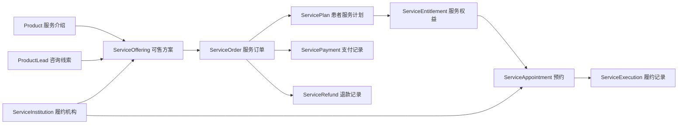

# 服务方案首期闭环实施计划

> 执行依据：`docs/product/SERVICE_PROGRAM_REQUIREMENTS.md` V1.2。实施时按任务顺序推进，每个任务完成后单独评审和提交。

**目标：** 在现有小程序、管理后台与 API 中交付单机构、本人购买、单次服务的咨询、资格确认、下单支付、预约、履约和退款闭环。

**架构：** 保持 NestJS 模块化单体和 PostgreSQL，新建 `service-program` 领域；公开介绍与咨询继续复用 `Product`、`ProductLead`，商城订单继续独立。服务订单只复用微信支付渠道能力，不复用商城订单状态和发货模型。

**技术栈：** NestJS、Prisma、PostgreSQL、Vue 3、Element Plus、UniApp、微信支付 API v3。

---

## 1. 方案选择

| 方案 | 内容 | 优点 | 代价 | 顺序 |
| --- | --- | --- | --- | --- |
| A：垂直闭环逐步交付 | 先单机构、单次服务，再扩多次套餐、商品交付和结算 | 每一步均可验收，支付和退款风险可控 | 完整范围分多次上线 | 推荐 |
| B：一次性交付完整范围 | 同时开发套餐、商品、收益和多机构 | 功能一次齐全 | 状态组合多、联调周期长、上线风险高 | 不推荐 |

采用方案 A。首个闭环不包含套餐内实物、自动分账、医生护士账号、电子病历和通用工作流引擎。

## 2. 领域边界



- `Product` 负责公开内容和咨询入口，不保存成交规则。
- `ServiceOffering` 负责可售方案、价格、有效期、预约规则和版本。
- `ServiceOrder` 保存购买快照；后续改价不影响旧订单。
- `ServicePlan` 是患者购买后的统一入口。
- `ServiceEntitlement` 分别记录总量、预约占用、已使用、退款冻结和已退款数量。
- `ServiceAppointment` 管理预约状态；只有完成履约才核销权益。
- `ServicePayment`、`ServiceRefund` 保存服务交易资金状态，通过公共微信渠道能力发起请求。

## 3. 状态约束

### 3.1 服务订单

`pending_payment → paid → partially_refunded/refunded`，未支付订单可以进入 `closed`。

### 3.2 服务权益

可预约数量计算为：

```text
available = total - reserved - used - refundFrozen - refunded - expired
```

任何变更均在数据库事务中校验，结果不能小于零。

### 3.3 预约

`pending → confirmed → arrived → completed`；可从 `pending/confirmed` 进入 `cancelled`，确认后未到场进入 `no_show`。取消预约释放占用，完成服务将占用转为已使用。

### 3.4 退款

`pending_review → approved → processing → succeeded`；审核前可以进入 `withdrawn/rejected`，渠道失败进入 `failed`。批准只表示平台同意，微信渠道成功后才显示退款成功。

## 4. 实施任务

### 任务 1：建立服务领域数据模型

**文件：**

- 修改：`apps/api/prisma/schema.prisma`
- 新建：`apps/api/prisma/migrations/20261014000100_add_service_program_phase1/migration.sql`

**步骤：**

1. 新增 `ServiceInstitution`，显式关联运营主体 `Partner`，保存名称、地址、联系方式与状态。
2. 新增 `InstitutionStaff`，保存医生、护士和其他执行人员名册，不要求绑定用户账号。
3. 新增 `ServiceOffering` 与 `ServiceOfferingItem`，第一版每个方案只允许一个服务项目和一次权益，字段结构兼容后续多次套餐。
4. 新增 `ServiceOrder`、`ServiceOrderItem`、`ServicePayment`，金额使用整数分，保存方案、机构、价格和规则快照。
5. 新增 `ServicePlan`、`ServiceEntitlement`、`ServiceAppointment`、`ServiceExecution`。
6. 新增 `ServiceRefund` 与 `ServiceRefundEvent`，保存审核、渠道处理和状态时间线。
7. 为用户、产品、线索、合作方补齐双向关系；为业务查询和幂等键建立唯一索引。

**验收：** Prisma schema 能生成客户端；迁移只新增对象，不修改商城表和现有数据。

### 任务 2：提供方案维护与公开查询 API

**文件：**

- 新建：`apps/api/src/service-program/service-program.module.ts`
- 新建：`apps/api/src/service-program/offering/offering.controller.ts`
- 新建：`apps/api/src/service-program/offering/offering.service.ts`
- 新建：`apps/api/src/service-program/offering/offering.repository.ts`
- 新建：`apps/api/src/service-program/dto/offering.dto.ts`
- 修改：`apps/api/src/app.module.ts`

**接口：**

- `GET /service-products/:productId/offerings`：公开读取上架方案。
- `GET /service-offerings/:id`：公开读取方案详情。
- `GET /admin/service-offerings`：管理端分页查询。
- `POST /admin/service-offerings`：创建草稿。
- `PUT /admin/service-offerings/:id`：更新草稿或下架方案。
- `POST /admin/service-offerings/:id/publish`：校验后上架。

**关键校验：** 机构有效、产品类型为服务、售价与项目分摊金额一致、有效期大于零、上架方案字段完整。

### 任务 3：增加咨询资格确认

**文件：**

- 修改：`apps/api/src/product/dto.ts`
- 修改：`apps/api/src/product/product.controller.ts`
- 修改：`apps/api/src/product/product.service.ts`
- 修改：`apps/admin/src/views/product/leads.vue`
- 修改：`apps/admin/src/api/product.ts`

**步骤：**

1. 运营把线索更新为 `qualified` 时选择允许购买的方案和资格有效期。
2. API 校验方案与线索属于同一服务产品。
3. 保存资格记录和操作审计，小程序只返回业务结论，不返回专业诊断内容。

**验收：** 需评估方案在未确认资格时无法创建订单；无需评估方案可以直接下单。

### 任务 4：实现服务订单与权益发放

**文件：**

- 新建：`apps/api/src/service-program/order/order.controller.ts`
- 新建：`apps/api/src/service-program/order/order.service.ts`
- 新建：`apps/api/src/service-program/order/order.repository.ts`
- 新建：`apps/api/src/service-program/dto/order.dto.ts`
- 新建：`apps/api/src/service-program/plan/plan.service.ts`

**接口：**

- `POST /service-orders`：校验资格并创建 30 分钟待支付订单。
- `GET /service-orders`、`GET /service-orders/:id`：查询本人订单。
- `POST /service-orders/:id/cancel`：关闭本人未支付订单。
- `GET /service-plans`、`GET /service-plans/:id`：查询我的服务。

**事务规则：** 使用客户端幂等键防止重复下单；订单保存完整快照；支付成功事件只允许创建一次服务计划和权益。

### 任务 5：抽取公共微信支付渠道并接入服务订单

**文件：**

- 移动并调整：`apps/api/src/shop/payment/wechat-pay.service.ts`
- 新建：`apps/api/src/payment-channel/payment-channel.module.ts`
- 新建：`apps/api/src/payment-channel/wechat-pay.service.ts`
- 修改：`apps/api/src/shop/shop.module.ts`
- 修改：`apps/api/src/shop/payment/payment.controller.ts`
- 修改：`apps/api/src/shop/payment/payment.service.ts`
- 新建：`apps/api/src/service-program/payment/payment.controller.ts`
- 新建：`apps/api/src/service-program/payment/payment.service.ts`

**步骤：**

1. 公共层仅负责微信签名、下单、查询、验签、解密和退款调用。
2. 商城与服务分别维护支付记录和业务状态。
3. 统一回调入口按商户订单号前缀定位业务类型。
4. 回调和主动查询均调用同一个幂等的“确认支付”方法。

**验收：** 商城原支付流程保持可用；服务支付成功只发放一次权益；未知订单号进入异常日志。

### 任务 6：实现预约与履约 API

**文件：**

- 新建：`apps/api/src/service-program/appointment/appointment.controller.ts`
- 新建：`apps/api/src/service-program/appointment/appointment.service.ts`
- 新建：`apps/api/src/service-program/dto/appointment.dto.ts`
- 新建：`apps/api/src/service-program/execution/execution.service.ts`

**接口：**

- `POST /service-plans/:id/appointments`：患者提交预约并占用权益。
- `POST /service-appointments/:id/cancel`：按时间规则取消并释放权益。
- `GET /admin/service-appointments`：运营工作清单。
- `POST /admin/service-appointments/:id/confirm`：确认时间与人员。
- `POST /admin/service-appointments/:id/arrive`：确认到场。
- `POST /admin/service-appointments/:id/complete`：登记完成并核销。

**事务规则：** 预约占用、取消释放和完成核销使用条件更新；重复请求返回当前结果，不重复扣减。

### 任务 7：实现服务退款闭环

**文件：**

- 新建：`apps/api/src/service-program/refund/refund.controller.ts`
- 新建：`apps/api/src/service-program/refund/refund.service.ts`
- 新建：`apps/api/src/service-program/dto/refund.dto.ts`

**步骤：**

1. 患者选择未使用权益，系统按订单项目分摊快照计算退款额并冻结权益。
2. 关联预约先取消并释放占用，再转为退款冻结。
3. 后台审核通过后调用微信退款；审核通过和渠道成功分开记录。
4. 微信退款通知或主动查询确认成功后终结权益并更新订单。
5. 拒绝或用户撤回时释放冻结；渠道失败保留冻结并进入人工处理。

### 任务 8：管理后台方案、预约和订单页面

**文件：**

- 新建：`apps/admin/src/api/service-program.ts`
- 新建：`apps/admin/src/views/service-program/offerings.vue`
- 新建：`apps/admin/src/views/service-program/appointments.vue`
- 新建：`apps/admin/src/views/service-program/orders.vue`
- 修改：`apps/admin/src/router/routes.ts`
- 修改：`apps/admin/src/layout/index.vue`

**交互：** 使用现有 `AdminListToolbar`、`AdminListTable`、`AdminListPagination` 和图标操作；状态 Tab 分组；详情抽屉展示时间线；破坏性操作二次确认并要求原因。

### 任务 9：小程序购买、我的服务和预约页面

**文件：**

- 新建：`apps/miniapp/src/api/modules/service-program.ts`
- 修改：`apps/miniapp/src/pages/products/detail.vue`
- 新建：`apps/miniapp/src/pages/services/offering.vue`
- 新建：`apps/miniapp/src/pages/services/checkout.vue`
- 新建：`apps/miniapp/src/pages/services/payment-result.vue`
- 新建：`apps/miniapp/src/pages/services/index.vue`
- 新建：`apps/miniapp/src/pages/services/detail.vue`
- 新建：`apps/miniapp/src/pages/services/appointment.vue`
- 新建：`apps/miniapp/src/pages/services/appointment-detail.vue`
- 新建：`apps/miniapp/src/pages/services/refund-request.vue`
- 新建：`apps/miniapp/src/pages/services/refund-detail.vue`
- 修改：`apps/miniapp/src/pages.json`
- 修改：`apps/miniapp/src/pages/profile/index.vue`

**交互：** 按原型突出“下一步”；支付确认中不展示可用次数；列表按进行中、售后中、已完成和已关闭分组；接口失败保留重试入口。

### 任务 10：上线准备与验收

**文件：**

- 修改：`docs/engineering/API.md`
- 修改：`docs/engineering/DATABASE.md`
- 新建：`docs/operations/SERVICE_PROGRAM_GO_LIVE_CHECKLIST.md`

**验收场景：**

1. 咨询线索可追溯到产品、患者和来源主理人。
2. 资格确认前不能购买受限方案。
3. 同一微信支付通知重复到达只产生一份权益。
4. 预约、取消和履约后权益数量始终守恒。
5. 已使用权益不能进入普通未使用退款。
6. 审核通过不显示退款到账，微信确认后才显示成功。
7. 机构运营不能访问其他机构数据。
8. 现有商城下单、支付和退款不受影响。

## 5. 工程原则检查

- **KISS：** 维持模块化单体，首个闭环仅支持单次服务，不引入工作流引擎。
- **YAGNI：** 暂不实现套餐内实物、自动分账、家属代购和医生护士工作台。
- **SOLID：** 展示咨询、服务交易、预约履约、商城交付和支付渠道各自承担单一职责。
- **DRY：** 复用用户、产品、线索、权限、审计和微信渠道能力；资金与状态规则集中在领域服务内。

若直接扩展 `ShopOrder` 承载服务预约，会把发货、核销和部分退款耦合在一起，违反单一职责；因此保持服务订单独立。

## 6. 发布顺序

1. 数据模型和方案 API。
2. 后台方案维护。
3. 资格确认和服务下单。
4. 支付与权益发放。
5. 预约、履约和患者“我的服务”。
6. 退款闭环。
7. 多次套餐、主理人收益和机构结算。
8. 套餐内实物与多机构运营。
