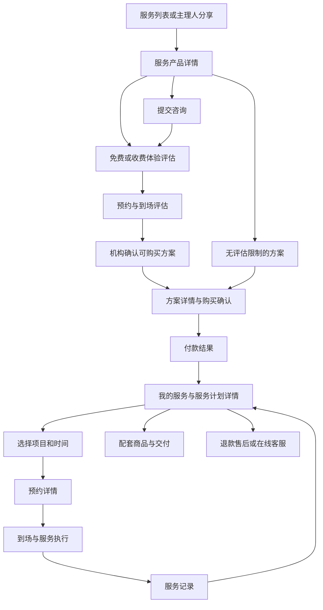

# 服务方案销售与履约需求确认文档

版本：V1.2  
日期：2026-10-14  
状态：需求已确认（第 17 章全部通过）  
确认日期：2026-10-14  
用途：后续交互原型、开发与验收的需求依据

本文确定一套完整的产品方案。用户已于 2026-10-14 确认第 17 章全部检查项无异议，V1.2 作为后续交互原型、开发与验收的需求依据。后续业务规则调整需记录变更并重新确认受影响内容。需求确认不代表功能已上线或结算协议已生效。

阅读顺序：先看第 5 章患者流程与页面，再看第 6 章各角色如何配合；第 7～15 章解释业务规则，第 16 章用完整案例串联，第 17 章用于逐项确认。

## 1. 产品定位

平台提供“服务介绍、咨询体验、方案购买、预约服务、配套商品、售后与收益结算”的完整流程。

患者通过小程序了解服务、购买方案、预约和查看执行进度；主理人推广并协助患者；机构负责实际服务；平台负责收款、订单、售后和结算。

涉及医疗服务时，医生决定患者是否适合接受服务及实际服务安排。购买方案不替代专业评估，不承诺治疗效果。本文以机构服务为业务对象，不定义任何疾病的治疗方法。

## 2. 产品范围

本产品支持：

- 免费咨询与免费体验。
- 收费评估、收费体验及单次服务。
- 包含多次服务或多种服务项目的套餐。
- 套餐内包含实物，以及患者另购配套商品。
- 主理人推广、患者归属与比例收益。
- 预约、改约、到场、服务完成、次数扣减和随访。
- 全额退款、剩余部分退款、异常售后。
- 平台收款、机构结算、主理人结算。

目前服务由一个机构提供。新增机构后，各机构分别管理自己的服务、人员、预约和履约记录；平台统一管理，患者购买时明确知道实际服务机构。

医生、护士无需操作平台。机构运营登记业务过程，医生护士在线下完成专业工作。产品不承担电子病历、处方、线上诊断、医疗耗材管理或医生护士工作台功能。

## 3. 参与角色

| 角色 | 职责 | 可操作内容 |
| --- | --- | --- |
| 患者 | 了解、购买并接受服务 | 咨询、支付、预约、改约、查看记录、售后、反馈 |
| 主理人 | 推广和协助 | 分享、跟进授权患者、协助预约、查看自己的收益 |
| 机构运营 | 协调与履约登记 | 跟进、排班、分配人员、确认到场、登记完成、随访 |
| 医生 | 专业评估与服务安排 | 线下决定适用性、服务内容和调整，不要求登录平台 |
| 护士 | 配合服务执行 | 线下执行职责，不要求登录平台 |
| 平台客服 | 咨询与售后协调 | 查询订单、协调预约、受理异议与退款申请 |
| 平台财务 | 核对资金和结算 | 审核退款、核对收益、生成结算单、登记付款 |
| 平台管理员 | 产品与规则管理 | 服务发布、机构管理、权限、收益规则、异常审核 |

患者查看自己的信息；主理人只查看授权联系信息、服务进度摘要和本人收益，不查看患者专业诊疗资料；机构只查看本机构业务。

## 4. 服务产品与可售方案

### 4.1 服务产品

服务产品是对外展示的入口，一个服务产品可以提供多个购买方案。

产品详情包括：名称、图片、服务机构、服务介绍、适用范围说明、体验与服务流程、服务地点、可选方案、价格、常见问题和客服入口。

明确显示“具体服务安排由机构评估确认”。不使用保证治愈、效果保证等销售承诺，患者体验与服务反馈不作为疗效证明。

### 4.2 方案类型

| 类型 | 患者行为 | 平台结果 |
| --- | --- | --- |
| 免费咨询 | 留联系方式和咨询需求 | 生成咨询记录，安排跟进 |
| 免费体验 | 选择体验项目并预约 | 获得一次体验名额，预约后到场 |
| 收费评估／体验 | 购买后预约 | 获得对应项目一次服务资格 |
| 单次服务 | 购买一个服务项目 | 获得一次对应服务资格 |
| 多次套餐 | 购买包含多项或多次服务的方案 | 分项目显示可用、已预约和已完成数量 |

免费体验每位患者每个体验方案限领取一次。正常取消可以重新预约；无故未到场的体验需由客服恢复预约资格。

### 4.3 每个方案的维护内容

- 名称、所属服务产品、实际服务机构。
- 项目明细、每个项目次数、包含的实物与数量。
- 售价、每项成交分摊金额及每项机构结算单价。
- 是否需要先评估、是否包含收费评估。
- 有效期天数、可预约日期与接待容量。
- 适用说明、预约须知、退款规则。
- 主理人默认收益比例及指定主理人的专属比例。
- 上架、下架状态。

方案上架前，各项分摊金额之和必须等于成交总价。套餐优惠分配到各项内容；后续退款以购买时的分摊价格为准。

患者购买时保存当次内容、价格、有效期和规则；后续改价或下架不影响已购买服务。

## 5. 患者流程与页面

### 5.1 完整使用路径

患者只需理解三件事：购买了什么、下一步要做什么、还剩多少内容。各页面优先突出当前行动，服务记录、资金和客服作为辅助入口。

### 5.2 服务列表与产品详情

| 页面 | 展示内容 | 主要操作 | 去向与状态 |
| --- | --- | --- | --- |
| 服务列表 | 服务名称、机构、简要介绍、起始价格、体验标识 | 查看服务 | 打开产品详情；下架服务不再向新患者展示 |
| 产品详情 | 机构、地点、服务范围、流程、可选方案、价格、常见问题 | 咨询了解、预约体验、查看方案 | 分别进入咨询、体验方案或方案详情 |
| 产品详情：已购买 | 上述介绍，以及有效购买提示 | 查看我的服务 | 优先进入已有服务计划，仍允许查看其他可售方案 |
| 产品详情：需要评估 | 评估要求、可预约评估内容 | 预约评估 | 尚未获可购买确认时不提供直接购买治疗服务的按钮 |

未登录患者可浏览。提交咨询、领取体验、购买或预约时进入登录，完成后回到原操作页面，不要求重新寻找服务。

### 5.3 咨询与评估

| 页面 | 展示内容 | 按钮与行为 | 下一步 |
| --- | --- | --- | --- |
| 咨询表单 | 所选服务、联系信息、需求描述、联系授权 | 提交咨询 | 成功页显示咨询已提交、查看咨询和联系客服 |
| 我的咨询 | 待联系、跟进中、可购买、已结束的咨询记录 | 查看详情 | 进入咨询进度页 |
| 咨询详情 | 咨询内容、机构反馈、业务进度、可选择方案 | 预约评估、查看方案、联系客服 | 根据当前进度显示对应操作 |
| 免费体验详情 | 项目内容、一次名额、机构、有效期与预约须知 | 领取并预约 | 先取得名额再进入预约；已领取显示预约或已有预约 |
| 收费体验／评估详情 | 项目、次数、价格及规则 | 购买评估 | 进入购买确认，付款后预约 |
| 评估后的咨询详情 | 可购买、需补充沟通或不适合购买的业务反馈 | 查看可购买方案或联系客服 | 只展示机构确认的购买入口，不展示专业诊断 |

咨询提交成功不显示为预约成功。体验名额领取成功也不代表具体时间已确认。

### 5.4 方案详情、购买与付款结果

| 页面 | 展示内容 | 按钮与行为 | 去向与状态 |
| --- | --- | --- | --- |
| 方案详情 | 服务项目、次数、含商品、机构、售价、有效期、近期可约日期、预约及退款规则 | 确认购买 | 不适合购买、缺货或下架时解释原因，提供客服入口 |
| 购买确认 | 本人信息、逐项内容与金额、总价、有效期、来源主理人、购买协议 | 确认并支付 | 患者确认规则后提交；不能替他人购买 |
| 待付款订单 | 成交内容、应付金额、30 分钟付款倒计时 | 继续付款、取消订单 | 超时关闭后可返回方案重新购买 |
| 付款结果：成功 | 金额、购买内容、实际机构 | 去预约、查看我的服务 | 进入预约或服务计划 |
| 付款结果：确认中 | 正在确认支付结果 | 刷新结果、查看订单 | 未确认成功前不显示可用服务次数 |
| 付款结果：未完成 | 未完成付款的说明 | 返回订单、继续付款 | 不误显示已获得服务资格 |

支付后涉及多个服务项目时，先选择本次预约的项目，再选时间。包含实物时提示完善收货信息或到场领取，不再次收费。

### 5.5 我的服务与服务计划详情

“我的服务”设置全部、进行中、售后中、已完成、已到期、已退款／已关闭分组。每张卡片显示方案、机构、有效期、剩余次数、最近预约和售后标记。

主分组按以下优先顺序确定，避免同一服务计划在多个状态下重复出现：

1. 全部内容已退或已终止，且没有未完成交付及售后事项：已退款／已关闭。部分已完成、其余已退款的计划显示“部分完成，剩余已退款”。
2. 存在仍可使用或已预约的服务，或未冻结的待交付商品：进行中；存在部分售后时增加售后标记。
3. 没有可继续履约的内容，但存在退款、退货或服务异议：售后中。
4. 无进行中售后，全部内容已交付：已完成。
5. 存在已过期的未使用服务，且无其他待履约或售后内容：已到期。

到期的服务不作为可用次数；已有的有效预约按预约规则处理。全部分组可查到所有已付款或已领取的服务计划；未支付订单在订单列表查看。

服务计划详情从上到下展示：

1. **当前下一步**：预约下一次、查看最近预约、等待机构确认或查看售后进度。
2. **方案概览**：机构、服务地点、购买内容、有效期。
3. **服务项目**：每项可用、已预约、已完成、售后冻结的次数。
4. **预约与服务记录**：时间、业务状态和实际执行人员。
5. **实物交付**：包含商品、交付进度，以及另外购买的商品。
6. **订单与售后**：订单详情、申请退款、服务异议、客服。

| 当前情况 | 主操作 | 辅助操作 |
| --- | --- | --- |
| 有可用次数、没有预约 | 预约下一次 | 查看记录、申请退款 |
| 有待确认预约 | 查看预约 | 取消申请、联系客服 |
| 有已确认预约 | 查看到场安排 | 按规则改约或取消 |
| 部分内容售后冻结 | 查看售后进度 | 其他可用项目仍能预约 |
| 全部服务已完成 | 查看服务记录 | 提交服务异议、联系客服 |
| 已到期但有未使用内容 | 联系客服处理 | 查看剩余内容和退款规则，不直接预约 |

返回页面和主动刷新时更新状态。加载失败提供重试；显示旧信息时明确提示，不能把旧数据当作最新进度。

### 5.6 预约与预约详情

预约页依次选择项目、可用日期和时段；显示地点、占用一次服务、剩余次数及到场须知。无可用时间时提供其他日期和客服入口，不显示可点击的无效时段。

| 预约状态 | 页面内容 | 可用操作 |
| --- | --- | --- |
| 待确认 | 已提交时间、机构确认截止时间 | 自行取消申请、联系客服；超时自动释放 |
| 已确认 | 时间、地址、到场指引、分配人员、预约须知 | 查看导航、按规则改约／取消 |
| 机构提出改约 | 原时间、替代时间、原因及回复截止时间 | 接受新时间、联系协调、取消；候选时段未接受前不占用名额 |
| 已到场／执行中 | 当前接待进度 | 联系客服，不提供自行改约按钮 |
| 已完成 | 服务项目、时间、实际人员及记录 | 查看服务记录、反馈异议 |
| 已取消／未到场 | 原预约及原因 | 返回服务计划，由规则决定自行预约或联系运营 |

取消和改约先展示确认说明。待确认申请可随时取消；已确认预约距离开始时间超过 24 小时可自行处理，不足或等于 24 小时进入客服协调。未接受服务时始终提供“取消预约并申请退款”入口。

### 5.7 服务记录与随访

服务记录展示项目、实际完成时间、医生护士、次数扣减和运营登记信息。不展示专业病历。

“记录有误”进入异议表单，可选择未接受服务、项目不符、次数不符或其他原因，并填写说明。提交后显示处理进度，相关项目进入异议处理，不影响其他无争议内容继续使用。

随访展示机构联系安排和必要业务反馈，患者可反馈服务体验，不设置公开疗效评价。

### 5.8 商品交付

套餐内商品卡片显示规格、数量、交付方式和进度。现场领取提供领取确认；寄送显示地址、物流与收货确认。已交付商品提供“申请退货”，显示退货条件、运费承担、寄回信息、收货核验和退款进度。

另购商品标明“另外购买，独立收费”，进入商城商品详情和购买流程。套餐内商品不得出现再次支付按钮。

### 5.9 退款、服务异议与客服

| 页面 | 内容与操作 |
| --- | --- |
| 退款申请 | 选择未使用服务和未交付商品，展示逐项金额、总额及冻结说明，填写原因后提交；已交付商品进入退货申请 |
| 有关联预约 | 提供“取消预约并申请退款”，列明受影响预约；客服统一处理，患者无需先另行取消 |
| 退款详情 | 当前进度、申请内容、金额、关联预约／退货和处理说明，刷新、撤回未审核申请、在线客服 |
| 异议详情 | 业务问题、机构反馈、客服负责人、处理期限和结果；已完成服务的例外退费从此受理，结果有争议可申请复核 |
| 在线客服 | 携带方案、订单或预约咨询信息，支持主动发送和复制，不携带专业诊疗资料 |

退款成功时显示“退款成功，请核对原支付账户”；只在支付渠道确认后显示成功。待审核申请允许患者撤回；进入退款处理后通过客服协调，不提供直接撤回按钮。

## 6. 主理人、机构运营与财务流程

### 6.1 主理人：推广到收益

**选择产品／方案 → 分享 → 患者主动建立来源 → 跟进授权咨询 → 协助预约 → 查看成交 → 查看收益与结算。**

| 页面 | 展示内容 | 主要操作 |
| --- | --- | --- |
| 推广产品 | 可推广方案、价格、自己的生效比例与规则 | 分享产品或方案 |
| 我的患者 | 授权联系信息、待跟进事项、咨询和预约摘要 | 联系、填写跟进、发起预约建议 |
| 患者业务详情 | 咨询、评估业务结论、成交和服务进度摘要 | 协助沟通，不替患者确认服务安排 |
| 我的收益 | 预计、观察期、可结算、已结算、冲回金额 | 查看订单项目明细和计算依据 |
| 结算单 | 周期、收入、抵扣、实付和付款记录 | 查看明细、提交结算异议 |

主理人发起预约建议后由患者确认；不能直接为患者扣次、确认服务完成或批准退款。来源归属和收益按患者与服务产品分别显示，不能把某个产品的来源归属解释为该患者全部业务的长期归属。

### 6.2 机构运营：咨询到履约

**处理咨询 → 安排评估 → 登记可购买结论 → 协调方案 → 确认预约与人员 → 到场 → 登记服务完成 → 随访或异常处理。**

| 页面 | 展示内容 | 主要操作 |
| --- | --- | --- |
| 工作首页 | 待联系、待确认预约、今日接待、异常、随访 | 进入相应工作清单 |
| 咨询跟进 | 来源、授权联系信息、需求、跟进记录 | 联系、安排评估、登记业务结论 |
| 预约日历 | 机构接待容量、人员安排、预约及不可接待时间 | 确认、提出改约、分配人员 |
| 今日接待 | 患者、项目、时间、到场状态 | 确认到场、未到场、执行异常 |
| 服务登记 | 项目、剩余次数、实际执行人员、时间与依据 | 登记完成、报告异常、申请撤销错误记录 |
| 患者服务详情 | 购买、预约、执行、商品、随访与售后 | 创建报价、协调服务调整、创建随访 |
| 商品交付 | 套餐商品、数量、领取或寄送进度 | 安排交付、登记交付依据 |

医生护士信息在人员名册维护，无需创建平台账号。运营登记前必须核对实际执行事实，不代替专业人员作诊疗判断。

### 6.3 平台客服：协调与售后

**接收咨询／异议 → 查看订单与执行事实 → 联系患者和机构 → 给出处理方案 → 患者确认 → 提交退款或修正处理 → 通知结果。**

客服可协调 24 小时内改约、未到场、到期未使用、金额争议及服务记录异议。客服不能自行更改已完成记录或登记资金已支付；对应处理进入管理员或财务审核。

### 6.4 财务：退款与结算

**核对退款 → 审核应退金额 → 处理原路退款 → 核对计提及冲回 → 生成结算单 → 审核付款 → 登记凭证。**

| 页面 | 展示内容 | 主要操作 |
| --- | --- | --- |
| 退款审核 | 申请、分摊金额、执行和交付事实 | 审核通过或拒绝并说明原因 |
| 退款进度 | 待处理、处理中、成功、异常 | 跟进异常，不能把批准当作到账 |
| 主理人收益 | 比例、计提、冻结、冲回及历史付款 | 核对金额，处理结算异议 |
| 机构应结算 | 每项完成内容、固定单价、观察期与异议 | 核对机构结算明细 |
| 月度结算单 | 所属主理人／机构、明细、抵扣与实付 | 审核、记录付款和凭证 |
| 收支汇总 | 收款、退款、机构结算、推广收益及其他费用 | 查看期间及订单汇总 |

已支付记录不直接覆盖；错误与退款通过冲回、补付或调整记录处理。

### 6.5 平台管理员：产品与运营规则

维护机构、人员权限、服务产品、方案、接待规则、有效期、价格分摊、机构单价与推广比例。发布前确认信息完整；下架后阻止新购买，已成交服务继续履约。

管理员处理来源争议和履约登记纠错，记录理由。多个机构分别管理自己的业务，平台可按机构汇总运营与资金情况。

## 7. 咨询与成交规则

患者流程：

**了解产品 → 咨询或预约评估 → 机构确认服务安排 → 确认方案 → 支付 → 预约执行 → 查看记录 → 继续服务或售后。**

需要评估的服务，患者先预约免费或收费评估。运营根据医生确认登记“可购买”“需要补充沟通”或“不适合购买”，同时记录确认医生、机构、确认日期、允许购买的具体方案、资格截止日期和确认依据，不在平台填写专业诊断。

购买资格只对指定患者、机构和方案有效；有效截止日期由机构根据医生确认填写，不能留空。过期后重新评估，不能凭一次评估购买其他受限制方案。方案内容发生实质变化时，机构重新确认适用性。

患者情况变化时，机构可暂停相应资格及未执行服务，通知患者并明确复核安排。已购买内容不因暂停被扣次；机构原因产生的等待期顺延，不能继续服务时办理剩余部分退款。

未获得可购买确认的患者，不能直接购买受评估限制的方案。已经购买的收费评估正常履约，后续是否购买其他服务由患者决定。

运营可以替患者创建方案报价和预约草稿；患者确认价格、服务内容与时间后生效。主理人不能替患者同意协议或支付。

变更已购方案采用“保留已完成部分，退还被替换的未使用内容，再购买新方案”的流程，不直接换项或以差价改写原订单。

机构先提供原方案剩余明细、新方案及报价，患者确认后统一处理关联预约和原订单退款。原订单退款成功后再购买新方案，新方案独立支付和预约，不承诺沿用原时段。已经交付的商品按退货规则处理，可以保留且不重复购买。

未退款的已完成项目保留原机构单价和收益规则；被退项目撤销相应收益。原订单变更所产生的替代购买沿用原主理人来源，新方案使用患者确认报价时展示的比例与价格，不重新抢占推广归属。患者额外购买、不替代原内容的服务按普通购买规则处理。

## 8. 支付与服务有效期规则

平台统一收款。患者付款后可在“我的服务”看到：

- 实际服务机构和服务地点。
- 购买方案及金额。
- 每项服务的可用、已预约、已完成、售后冻结数量。
- 下一次预约及历史预约。
- 服务执行记录和随访提醒。
- 套餐内实物交付与另外购买的商品。
- 订单、退款、客服入口。

付费订单付款等待时间为 30 分钟，超时关闭；再次购买需重新确认订单。预约与购买分开操作，支付页面不承诺某个时段已为患者保留。

方案详情与购买确认展示近期可预约日期和最早可约时间，并注明仅供参考、预约需机构确认。机构尚未开放任何可约时段时，暂停该方案的新购买，保留咨询入口。

服务有效期从支付成功日起计算，免费体验从领取日起计算；页面显示明确截止时间。预约的服务开始时间须在有效期内。有效期内可以申请剩余部分退款，到期后未使用服务停止新预约，由客服受理延期或退款，不直接清零为已使用。

患者首次提出预约后，因机构无档期、取消接待或资格复核而无法安排的，运营登记受影响项目及等待起止时间，按无法提供服务的实际天数顺延有效期并通知患者。等待从首次提出但无法满足的预约日期起，到机构首次提供可用替代日期止；不足一天按一天计算，重叠等待不重复累计。患者不接受替代安排时可以申请未使用部分退款，不强制延期。

患者主动推迟或未到场不自动延期。因机构原因延后的预约如跨越原有效期，先顺延再确认，不能要求患者重复付费。

第一版仅支持本人购买并使用，不支持把套餐转让给其他患者或家属代购。

## 9. 预约与改约

### 9.1 预约

患者选择服务项目、机构可用日期与时间。运营根据排班分配医生、护士；患者无须自行选择专业人员。

预约提交后先显示“待确认”，机构确认后显示“已确认”。预约占用一次服务资格，不能超过剩余次数或接待容量。同一患者不能预约时间重叠的服务。

机构应在收到预约申请后的 4 个工作小时内确认；确认截止不得晚于预约开始前 1 小时。工作小时按页面公布的机构接待时间累计；距开始不足或等于 1 小时的预约由客服现场协调，不接受在线申请。到截止时间仍未确认，申请自动取消，释放次数和容量，并通知患者重新预约或联系客服。

机构不能提供所选时间时，提出替代时间；患者确认后改约，不擅自更改。候选时段不占用名额，患者接受时再次确认可接待情况；已满时由运营重新协调。原时段能够继续提供时保留原预约，原时段已无法提供时明确取消并释放，不让患者误以为仍可按原时间到场。候选改约建议最迟在候选时段开始前 1 小时失效，页面显示截止时间；未接受时不自动生成新预约，也不自动取消仍可提供的原预约。

### 9.2 取消、迟到与未到场

- 待确认申请：患者可随时取消，释放次数和容量。
- 已确认预约距开始时间超过 24 小时：患者可自行取消或改约，释放次数，不扣费用。
- 距开始时间不足或等于 24 小时：由客服或运营处理，未实际提供服务不自动扣次。
- 迟到：运营与患者协商继续接待或改约，不自动扣次。
- 未到场：登记未到场，不登记服务完成；后续预约需运营确认。
- 机构取消：主动协调改约；患者不接受替代安排时，可申请对应未使用部分退款。

预约占用在取消或登记未到场后释放。非工作时间和不可接待日期不允许预约。

## 10. 到场、执行与完成

运营确认患者到场，并记录实际医生、护士和服务项目。实际服务由机构在线下完成。

服务完成后，运营登记完成时间、实际执行人员及完成依据，扣减一次对应服务资格。登记人和执行人分别显示，重复登记不能重复扣次。

患者在“我的服务”查看记录，可以提交“未接受该服务”“项目或次数不符”等异议。患者未主动确认，不影响有完成依据的履约记录，但发生异议时暂停对应收益和机构结算。

未开始的服务不扣次；服务中止或执行异常由运营登记异常并交客服协调，不自动按完整一次计费。需要按实际完成内容结算时，先向患者说明并取得确认。

登记错误可以申请撤销，管理员审核后恢复次数并修正相关结算，保留原记录和修改原因。

服务异议由平台客服受理，在 1 个工作日内首次联系患者；机构在受理后 2 个工作日内提供执行依据，客服在收到依据后 2 个工作日内给出处理方案。需延长时，在原期限内说明原因和下一次反馈日期，不静默挂起。

处理结果包括维持记录、纠正项目／次数、重新安排服务或例外退款。患者不同意结果时可申请平台管理员复核，管理员在 3 个工作日内反馈；原登记人员不能自行终结异议。患者接受处理方案且完成相应处理后结案；患者不接受复核结果时继续标记争议协调，不因管理员已回复就自动结案。异议处理不以患者沉默为同意；尚未解决的争议继续冻结相关未支付结算，其他项目正常处理。

每次服务后，运营可创建随访任务，记录联系时间与业务反馈；专业诊疗内容由机构保管。

## 11. 配套商品

### 11.1 患者另外购买

在服务介绍或“我的服务”展示相关商城商品。患者自主下单，独立收费、交付和售后；商品订单显示关联的服务计划。

医生的专业决定与商品营销分别管理，不因购买某个服务就自动要求购买商品。

### 11.2 套餐内含实物

购买前列明商品名称、规格、数量、分摊价格和交付方式。患者不再次支付商品款。

支持机构现场领取和物流寄送。交付记录显示待交付、已领取或已签收；领取由患者确认，无法确认时由运营记录交付依据。

套餐内实物在销售时占用对应库存，退款或订单关闭按实际交付情况释放。商品缺货时不能销售包含该商品的套餐；替换规格或商品必须经患者同意。

机构治疗耗材不作为套餐商品交付给患者，不在患者商城订单中记录。

## 12. 退款与售后

### 12.1 退款范围

- 全部内容未使用、未交付：可申请全额退款。
- 部分服务已完成：按未使用项目的购买分摊价格申请退款，不重新按当前单次售价扣费。
- 套餐实物未交付：可以退对应分摊金额；已交付商品进入本章退货流程，核验后退对应分摊金额。
- 已完成服务不提供直接退款入口；患者仍可提交服务异议，由平台受理例外退费。
- 未使用部分不扣违约金或支付手续费。

患者提交退款前看到申请内容和金额。尚有预约的未执行项目可直接选择“取消预约并申请退款”，一次列明受影响预约、次数与金额，不要求先完成另一笔取消操作，不重复提交同一部分内容。

申请后这些预约显示“取消待处理”，暂停接待和履约登记，对应次数转为售后冻结；运营取消原时段并释放容量，客服继续处理退款。已到场尚未执行时先由运营确认未执行事实；实际执行中的服务进入异议处理，不按未使用项目直接退款。

### 12.2 退款处理

申请后冻结对应次数和商品交付，其他不涉及的项目继续使用。客服核对履约事实，财务审核金额，平台处理原路退款。

患者查看“待审核、处理中、退款成功、未通过、异常处理”的进度。审核批准不显示为已经到账，不承诺固定审核或银行到账时间。

申请被拒绝或由患者撤回后解除退款冻结，剩余次数按有效期恢复可预约或到期状态。已取消的预约不自动恢复，需要重新选时段。退款成功后终结已退部分；退款异常时保持冻结并由客服处理，不要求患者重复申请。

所有退款申请汇总在服务订单售后中。套餐内实物不会另开一笔重复退款；患者独立购买的商城商品仍走商城售后。

### 12.3 套餐商品退货

购买前逐项展示可退条件、申请期限和运费承担。普通商品支持交付后 7 天内未使用且保持完好的退货；涉及特殊商品时由平台设置并明确展示适用条件，不能仅以套餐或赠品名义排除质量问题受理。错发、缺损和质量问题始终保留客服受理入口，超过普通退货期也可提交问题。

患者选择商品、数量、原因和必要照片，客服在 1 个工作日内受理。批准后展示退货地址及联系人；患者在 7 天内寄回并填写物流，无法按时寄回可联系客服延期。逾期未寄回的申请由客服提醒后关闭，保留重新联系入口，不记为退款成功。

错发、缺损、质量问题的退货运费由责任方承担，平台先协调处理；患者个人原因退货由患者承担寄回运费，原运费是否计入成交金额在购买前单列，不在退款时新增扣费。

收货后 2 个工作日内核验数量、状态与问题，符合条件则按原分摊金额退款。不符合时展示核验依据，进入异议协调，不直接弃置商品或结束售后。现场退回同样记录收货与核验。

已批准退货冻结对应商品的未支付结算；服务项目仍按自身状态继续使用。退货成功后只冲回该商品应调整的收益与成本，已退回实物检验合格后才能重新销售。

所有套餐内实物，包括展示为赠品的实物，均在购买前明确分摊金额，不在退款时临时增加赠品补价。零元赠品可随对应服务退款一并申请退回，患者保留时不额外扣款；商品退货不改变其他服务原有单价，部分服务退款也不重算保留商品价格。

## 13. 主理人推广、归属与收益

### 13.1 患者归属

主理人拥有专属分享入口。患者主动提交咨询、领取体验或购买时记录有效来源，单纯浏览不建立患者归属。

来源按“患者＋服务产品”分别建立，采用首次有效来源、30 天有效规则。同一服务产品下的不同方案及窗口内复购归属同一主理人；不同服务产品分别记录，不自动扩展到患者全部消费。

30 天从首次有效来源建立时起计算，期间再次点击或咨询不延长，其他主理人分享不覆盖。窗口到期后，患者通过新的有效来源再次主动咨询、领取体验或购买，重新建立 30 天归属；没有新来源的自然复购不计收益。购买确认页展示本单来源，患者可联系平台纠错。

订单创建时在有效窗口内即固定该单归属，患者在该订单付款期限内完成支付仍计入；取消或超时后新建订单，按新建时的有效来源判断。方案替换购买沿用第 7 章的原订单归属。

订单成立后归属固定。争议由管理员凭记录调整，保存原因并通知受影响主理人；已结算订单不直接变更。

主理人本人购买不产生推广收益。患者取消、重新购买不会重复累计同一笔服务的收益。

### 13.2 比例与计提

收益比例按方案配置，可以给指定主理人设置专属比例，专属比例优先。未配置时比例为 0%，不产生收益。

服务收益按每项实际成交金额计算，在实际完成服务后计提。免费咨询、免费体验、未支付订单、未完成服务和未交付商品不计提。

套餐内商品在交付确认后按对应分摊金额计提，比例单独配置；另购商品沿用商城的推广规则，没有配置则不计提，不继承服务比例。

订单记录购买时比例，后续修改不追溯已有订单。金额按分计算，出现尾差时在最后一项完成或订单最终结算时统一校正。

### 13.3 结算

完成交付后，从完成记录首次对患者可见的时间开始累计 7 天观察期；运营补录过去的执行时间不能缩短观察期。患者有售后异议时暂停计时，争议解决并通知患者后继续累计剩余时间；计时结束且无未解决事项才进入可结算。7 天为结算观察期，不是患者反馈问题的截止期。

每月 5 日汇总上月及以前已完成交付、在出单时已满足条件且尚未结算的收益，形成结算单（遇非工作日顺延至下一个工作日）；财务在出单后 5 个工作日内审核并完成无争议部分付款。收款资料不完整时通知补齐，补齐后 5 个工作日内处理。单据显示预计付款日、实际付款日和异常原因；出单不等于已付款。

有退款或异议的项目暂停结算。退款取消相应未支付收益；已支付收益退款后形成冲回明细，在后续结算中抵扣。合作终止时结清冲回余额。

平台只展示销售与履约收益，不以病情、疗效或治疗结果作为收益计算条件。可开放的推广方案由平台审核发布。

## 14. 机构结算与平台收入

采用“按项目固定结算单价”的方式。每项服务及套餐实物明确机构结算单价，订单成立后固定；后续机构调价不影响旧订单。

机构按实际完成服务及已交付商品获得结算，未执行、未交付、退款或存在争议的项目不进入当次可结算。

机构结算采用第 13.3 节相同的观察期起算、暂停、恢复、月度出单和付款期限。由财务人工审核并登记实际付款；不提供自动提现或自动分账。

平台贡献毛利按“实际收款－退款－机构结算净额－主理人收益净额－平台承担的商品成本净额”展示。净额包含相应冲回；支付费用、税费和其他经营费用另列，不称为净利润。

商品由机构提供且成本包含在机构结算时，不重复扣平台商品成本；商品由平台采购时，另列平台承担的成本。退回可重新销售商品时调整对应已售成本，损耗单独列示，不能因退款成功直接视为成本全部收回。

付费方案发布前，分别核对每项分摊金额、机构结算、推广收益和平台商品成本，方案总成交价须覆盖总成本与收益支出。零元赠品的成本纳入套餐总成本，不能漏算。免费体验由平台设置机构体验结算单价并承担推广费用，预算达到活动上限后停止发放新名额。

对已完成部分的例外退款，由财务明确机构及主理人需冲回金额；平台补偿类退款单独记录承担方，不自动扣除机构已提供服务的收入。

## 15. 提醒与客服

患者在小程序内看到购买、预约确认、机构改约、服务完成和退款状态提醒。微信消息按患者授权情况发送，不保证所有患者都能收到外部提醒。

预约前一天生成运营提醒任务；当天建立接待名单；未到场和服务异常进入运营待办。主理人可收到授权范围内的协助提醒，不接收医疗资料。

在线客服可携带订单与预约咨询信息。客服工作时间在页面真实展示，未回复时允许留言；紧急医疗问题提示联系机构或当地急救服务，平台客服不作诊断。

## 16. 完整业务示例

以下价格和比例仅演示本方案规则，不是实际发布价格。

1. 主理人分享服务产品，患者提交咨询，建立 30 天来源归属。
2. 患者领取免费体验，运营确认预约并安排机构人员。
3. 机构完成评估，确认患者可购买相应服务方案。
4. 患者购买 1,000 元套餐：十次服务共分摊 900 元，每次 90 元；配套商品分摊 100 元。
5. 服务推广比例 10%，每完成一次计提 9 元；商品比例 5%，交付后计提 5 元。
6. 服务机构每次结算 60 元，配套商品由机构提供，结算 70 元。
7. 患者完成三次服务并领取商品：完成金额 370 元，机构应计提 250 元，主理人应计提 32 元。
8. 患者申请剩余七次退款，金额为 630 元；退款期间这七次服务被冻结。
9. 退款成功后，剩余次数终结；既有三次服务与商品仍保留完成记录。
10. 无异议的完成项目满足观察期后进入月度结算。该订单最终贡献毛利为 88 元，支付费用等经营费用另行列示。

## 17. 需求确认检查项

确认记录：2026-10-14，用户明确表示“文档第 17 章 都确认没问题”。以下 14 项全部确认通过：

- [x] 平台收款、机构实际服务，医生护士不操作平台。
- [x] 免费、收费、单次、多次套餐及套餐内实物均纳入产品范围。
- [x] 有评估要求的方案按指定医生、机构、方案和有效期确认购买资格。
- [x] 本人购买使用，有效期从支付或领取日起计算；机构无法接待的等待期顺延或受理退款。
- [x] 待确认预约超时释放，实际完成才扣次；24 小时内改约由客服处理，取消与退款可合并申请。
- [x] 未使用按购买分摊价格退，不重新按单次原价扣费。
- [x] 按患者与服务产品建立 30 天来源归属，窗口内复购计入，方案替换沿用原来源。
- [x] 收益按完成交付计提，比例购买时固定，退款按对应项目冲回。
- [x] 机构采用固定项目结算单价，完成交付后计提。
- [x] 观察期从完成记录对患者可见时起累计 7 天，异议暂停；每月 5 日出单，5 个工作日内处理无争议付款。
- [x] 方案变更退未使用部分后重新购买；套餐商品有独立退货流程，不重复收退。
- [x] 平台采购商品成本单列，机构已包含的成本不重复扣除。
- [x] 运营登记实际执行人员与完成依据，患者可以提出异议。
- [x] 平台保存必要业务信息，专业诊疗记录由机构保管。

以上规则作为已确认需求执行。下一步制作患者端与机构运营端交互原型，再据此拆分开发与验收任务。实际收费、结算及正式发布按对应上线流程执行。
